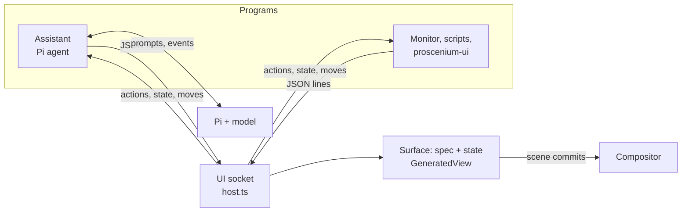

# Generated interfaces: the design

How generated interfaces in Proscenium look, behave and fit together, and why.
[GENUI.md](GENUI.md) is the reference: the protocol, the catalog, the files.
This document is the reasoning behind them.

## The idea

An interface is described, not drawn. A program, or the assistant, sends a
[json-render](https://github.com/vercel-labs/json-render) spec: a flat tree of
components from a fixed catalog, with state, bindings and actions. The world,
the React program that directs the compositor, draws it natively with
`proscenium/ui`, as compositor nodes beside the windows.

Three choices follow from that:

- **Programs own their interfaces; the world draws them.** A program needs no
  Wayland surface, buffer or toolkit. It sends JSON over a Unix socket and hears
  back what the person does. Its interfaces close when it disconnects.
- **The person decides where things live.** Every interface can be dragged
  between modes: in the chat, floating, pinned over everything, docked, on the
  canvas. The program is told, and doesn't get to move it back by accident.
- **Nothing generated costs anything while it is still.** Looks animate in the
  compositor, state changes redraw only what changed, and nothing loops except
  while work is under way.



## Who owns what

| Part | Owner | Notes |
| --- | --- | --- |
| Spec (elements) | The program | The world draws its copy; only the program changes it. |
| State | Shared | The world's copy is live. The program sets it; the person changes it through inputs; the renderer keeps its own under `/_ui`. |
| Mode and place | Shared | The program picks it when the interface is new and may `place` it later; the person drags it. The last move wins, and the program hears about the person's. |
| Chat transcript | The assistant | The world draws its copy. |
| Chat open, composer draft | The world | Saved with the world's persistent state. |

What makes this hold up:

- **Replay in order.** A program keeps each interface as the spec it opened
  with plus a log of every change since, its own and the person's, in the
  order they happened. A world that reloads gets them again in that order, so
  the latest change wins whoever made it. The log merges consecutive state
  changes and folds itself into the world's copy past 48 entries.
- **Element state in the interface's state.** An input the spec binds to
  nothing, and a countdown's clock, live under `/_ui/<element>/…`. So they
  survive moving between modes (which draws the card anew) and reloads, and
  the owner sees them in its actions.
- **Edits don't move.** Opening an interface that is open changes it where it
  is. Only `place`, or the person, moves it.
- **One assistant.** A newer one takes the chat; the older is told to stop and
  does. The world restarts the built-in assistant after a crash, with backoff,
  and starts it whenever the chat is open with no assistant.
- **Restarts.** The assistant saves its transcript, its interfaces and its Pi
  session, and restores them when it starts again. Programs started outside the
  session reconnect by themselves.

## Modes

| Mode | Where | Frame | Width | Use for |
| --- | --- | --- | --- | --- |
| Inline | In the chat message that made it | Slim | The chat's | Answers, forms, approvals |
| Floating | Anywhere on the screen | Full | 360 | Something to keep at hand |
| Overlay | A corner or edge, over everything | Slim | 300 | Timers, monitors, notes |
| Dock | Along the left or right edge | Full, stacked | 320 | Panels to work beside; windows make room |
| Canvas | In the world, with the windows | Full | 380 | Things that belong to a place on the canvas |
| Dialog | Centred over a dimmed screen | Full | 420 | Questions that need an answer |

Placement rules:

- Overlays sit in the space docks and the chat leave clear, so a monitor pinned
  top-right never covers the chat's header.
- The chat (420 wide, below the bar, 12 from the edges) moves left of a
  right-hand dock.
- Docks reserve their width with `<Reserve>`, so tiling worlds lay windows out
  around them.
- A dialog's backdrop takes presses, so nothing else can be clicked until it is
  answered; several dialogs stack in a column.
- Positions are whole pixels wherever they come from.

### Moving between modes

Drag any card by its title bar. A live copy lifts under the pointer, the card
it came from fades to 30%, and the place it would land lights up:

```
┌──────────────────────────────────────────────────────────────┐
│ ┌─corner─┐                                       ┌─corner─┐ │
│ │ pin    │                                       │ pin    │ │
│ └────────┘                                       └────────┘ │
│e                                                    ┌──────┐e│
│d              (anywhere else: float here)           │ chat │d│
│g                                                    │ back │g│
│e                                                    │ to it│e│
│ ┌─corner─┐          ┌──Pin to canvas──┐ ┌─corner─┐  └──────┘ │
└──────────────────────────────────────────────────────────────┘
```

- The outer 30 px of each side docks it.
- The 110 px corners of the clear area pin it over everything.
- The chat takes back interfaces that came from it.
- "Pin to canvas", at the bottom centre, leaves it in the world, kept in view.
- Anywhere else floats it where it was let go.

The copy hands its on-screen place to the card where it lands (`layoutId`),
so the card glides from the drop point rather than jumping. A card that moves
is drawn anew, so the copy's identity takes over cleanly. In the chat, a card
that moved out leaves a note with "Bring back".

## The frame

Every interface sits in the same frame, so generated content never has to draw
its own chrome:

- **Full bar** (34 px): the title in strong text, the owner's name after it in
  faint text on the same line (one Text node, so they share a baseline), and a
  close mark.
- **Slim bar** (28 px, inline and overlay): the title in a 12 px muted label,
  and the close mark.
- **Insets.** The title starts 14 px in, where the content starts, and the
  close mark's glyph ends 14 px from the right edge, where the content ends.
  Content has 14 px on both sides and below.
- **Fill.** White, or #26262b for dark interfaces. It is opaque, so whatever is
  behind never shows through.
- **Root card.** A `Card` at the spec's root draws no card of its own, since
  the frame already is one.

## The visual system

**Space.** 14 px inside and around cards, the frame and the chat. 8 px between
things in a row and between a card's children. 6 px between a label and its
control. List rows get 5 px above and below whatever they hold. A
`ListItem`'s highlight reaches 6 px past the content edge, so its words line up
with everything else.

**Type** (Noto Sans):

| Role | Size | Weight |
| --- | --- | --- |
| Heading 1 / 2 / 3 | 22 / 17 / 14 | 700 / 700 / 650 |
| Card and frame titles | 15 / 13 | 650 |
| Body, values beside labels | 13 | 500 |
| Labels (fields, metrics, table heads, chart values) | 12 | 600, muted |
| Badges | 11 | 650 |
| Metric value | 26 | 700 |
| Code, clocks | 12, and 18–46 for countdowns | Noto Sans Mono |

Text that shares a row with other text is the same size (a slider's label and
value), or part of the same Text node (a metric's number and unit), so
baselines line up.

**Colour.** Everything comes from the `proscenium/ui` theme: ink, soft, muted
and faint text, the accent, hover and press fills. Tones add success
(#16a34a, #4ade80 on dark) and warning (#d97706, #fbbf24 on dark). Interfaces
choose light or dark; `Card` with `variant: "ink"` puts its contents in the
dark theme.

**Motion.** One-shot springs from the theme: `pop` (0.26 s) for presses and
hovers, `glide` (0.34 s) for things that move, a 0.4 s slide for the chat, and
a 0.28 s critically damped spring for scrolling. Only an unknown-length
progress bar and the chat's typing dots loop, and only while they show.

### Sharp text

The compositor draws a text node's raster exactly where the node is. So:

- **Text sits on whole pixels.** It is aligned by layout (Yoga rounds to whole
  pixels), never by Pango inside a box: right-aligned numbers sit in a box
  justified to the end, and centred labels are centred by their parent. Pango
  aligns only the lines of long text that wraps.
- **Offsets are rounded.** Scroll offsets, drop positions and positions
  programs give are rounded too, and the caret is moved by whole pixels.
- **Measured.** A half-pixel vertical offset costs a quarter of a line's sharp
  strokes, and a horizontal one about half.

## Components

The catalog is small on purpose: 27 components a model can combine reliably.
Notes on the ones with design decisions in them:

- **Stack, Card, Grid, List.** Columns stretch their children; rows centre
  them. `Grid` makes equal cells. `List` puts hairlines between rows.
- **Button.** As wide as its label in a row or a column; `block: true` fills
  the width. Variants: plain, tinted, filled, danger.
- **Metric.** A 12 px label, then the value and its unit on one line, the unit
  at 14 px muted, then an optional delta (▲ green, ▼ red) and caption.
- **BarChart.** Horizontal bars with labels at 28% of the width and values in a
  64 px column, right-aligned by layout. Vertical columns take a height.
- **Sparkline.** Columns filling whatever width it gets, the latest one solid.
- **Countdown.** Its clock lives in the interface's state, so it keeps running
  wherever the card goes. `running` is meant to be bound to state, so Start and
  Pause are `setState` buttons. `resetTimer` puts it back to its seconds,
  stopped, setting the bound running to false. It wakes once a second while
  running.
- **Inputs** (`TextField`, `Switch`, `Checkbox`, `Slider`, `Tabs`). Bound with
  `$bindState` to paths the spec names, or kept under `/_ui` when bound to
  nothing.
- **Image.** Takes a path, or an https URL fetched once into a cache.
- **Failures.** An element that fails to draw shows why inside its own
  interface; an unknown type shows its name.

## The text field

`proscenium/ui`'s `TextField` is drawn by the world, not a client:

- **Focus.** Focused, it holds the keyboard with `useKeyboardGrab`: keys come
  to it, and windows lose keyboard focus meanwhile. One field is focused at a
  time. A press anywhere else, Escape, or the field going away lets go.
- **Caret.** A second, all-but-clear copy of the text lies over the first with
  a caret glyph inserted at the caret, wrapped between word joiners. Pango wraps
  both copies alike, so the caret lands where the text is on any line, without
  measuring anything. Its colour is `#00000001`, because the compositor skips
  text that is wholly clear.
- **Selection** is the same text with a highlighted span.
- **Keys:**
  - Arrows move by characters, and by words with Ctrl.
  - Home and End go to the line's ends, and to the text's with Ctrl.
  - Shift extends the selection; Ctrl+A selects all.
  - Ctrl+C, X and V copy, cut and paste.
  - Backspace and Delete remove characters, or words with Ctrl.
  - Return submits; Shift+Return adds a line in multiline fields.
- **Not supported yet:** a press doesn't place the caret (it goes to the end),
  and there's no input method for composed characters.
- **Wobble.** Typing made the text wobble by fractions of a pixel. That comes
  from the compositor, not the field: see Known limits.

## The chat

A 420 px panel below the bar at the right of the screen, opened with Super+A.

- **Header.** A sparkle, "Assistant" and the model's name on one line, plus New
  chat and close.
- **Messages:**
  - The person's: accent bubbles on the right.
  - The assistant's: its parts in order. Text is Markdown; tools show as small
    pills with a pulsing icon while they run and ✓ or ! after; an interface
    shows in place; one that moved out shows a note with "Bring back"; the last
    line of its thinking shows faintly while it is the newest thing.
  - Events, such as "Sent from Trip planner": centred, faint.
- **Scrolling.** The view keeps the newest message in sight while you're at
  the bottom; scrolling up stays put.
- **Composer.** A multiline field, plus a send button of the same height that
  becomes Stop while the assistant works. A message typed while it works waits
  in line. The draft is kept if the chat is put away or the world reloads.
- **First use.** With no messages: "What can I make you?" and three
  suggestions that send themselves.

## The assistant

A Pi agent in its own process, a client of the same socket as any program:

- **Tools.** `ui_render` writes interfaces as json-render patches. Pi streams
  a tool call's arguments as the model writes them, so each patch goes to the
  world as soon as the next begins, and the interface builds up as it's
  written. The id, mode and title are trusted only once the patches have begun,
  since half-written strings look like whole ones. `ui_place`, `ui_close`,
  `ui_read` and `ui_feed` work on interfaces it made; read, ls, grep, find and
  bash let it find real data.
- **Fixing its own work.** `ui_render` answers with what is wrong with the spec
  (missing children, unknown components, fields in the wrong place). When
  something is, the answer says it isn't finished and asks for a fix before
  replying. A model that skipped elements then adds them instead of giving up.
- **Approvals.** Every shell command waits on a card: Run, Allow all in this
  chat, or Don't run. Closing the card, or Stop, is Don't run. The card stays as
  a record of what was decided.
- **Round trips.** A button bound to `ask` sends the interface's whole state
  back as a message. The chat shows only where it came from; the model acts and
  usually patches the same interface.
- **Prompt.** A short one about the desktop, the modes and real data, followed
  by json-render's own catalog prompt adapted to the tool.

## Live data

Some interfaces show things that change by themselves: a system monitor, a
download, a build. Two ways to keep them current, both through state updates
(changing values re-renders that one interface and commits only what changed):

**From any program.** Open once, then push values:

```ts
const ui = new UIClient({ name: "Monitor" });
ui.open("system", { mode: "overlay", place: { anchor: "top-right" }, title: "System", spec });
setInterval(() => ui.state("system", { "/cpu": load(), "/memory": memory() }), 2000);
```

`examples/genui/demos/monitor.ts` is the whole thing in 80 lines. From a
language without the client, it's the same two JSON messages over the socket.
The program can run as a user service; its interface returns whenever the world
does.

**From the assistant.** `ui_feed` gives an interface a feed: a shell command
run every few seconds whose output goes into the interface's state, after the
assistant has answered.

- **Output format.** The simplest is one `name value` pair per line (into
  `"/"`), which fills `/name` for each line without any JSON quoting. A feed can
  also print a number, text, JSON or lines, and `keep: N` turns one path into a
  rolling list for a Sparkline.
- **Approval.** You allow the command once, like any other.
- **Failures.** The first run happens at once and is returned to the model; a
  command that fails then isn't started, so the model fixes it. A feed that
  later fails three times in a row stops, and the chat says why.
- **Lifetime.** Feeds end when their interface closes, are saved with the chat,
  and start again with the assistant.

Asked for "my CPU load and memory use, updating every 2 seconds, pinned in the
top right corner", the assistant writes the card, pins it, and feeds it from one
`printf`/`awk` command.

## Cost

Measured on the headless rig:

- With the gallery open and a pan, every frame matched a full redraw.
- Idle interfaces do nothing.
- A running countdown wakes once a second.
- A feed costs a shell run per tick in the assistant's process, plus a state
  update for one interface.
- The chat streams at most 25 updates a second and skips ones that change
  nothing shown.

## Known limits

- **The compositor squeezes text rasters.** A text raster is a whole number of
  pixels, but it is drawn into the text's fractional-size box (`src/media.c`
  `media_text_raster_box`). As text changes width while typing, the glyphs
  shift by fractions of a pixel: the wobble. All text is also a little soft.
  Snapping the raster box to whole device pixels fixes both. It's measured in a
  throwaway build: the glyphs never move while typing, plain text has 2.6× as
  many fully sharp stroke pixels, and frames still match full redraws. It's a
  change to C, waiting for a go-ahead.
- **Canvas mode follows the camera.** Cards pinned to the canvas are as sharp
  as the camera's position allows; after a fling it can rest between pixels,
  which softens windows too.
- **First output only.** Interfaces show on the first output.
- **Model reliability.** Codex Luna 6 at a low thinking level sometimes drops
  elements or fumbles deeply nested patches. The tool's feedback catches
  missing pieces; `PROSCENIUM_ASSISTANT_THINKING=medium` trades speed for fewer
  repairs.
