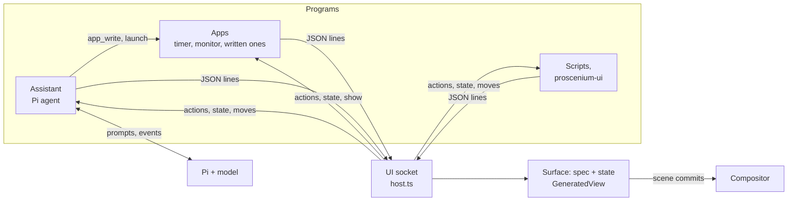
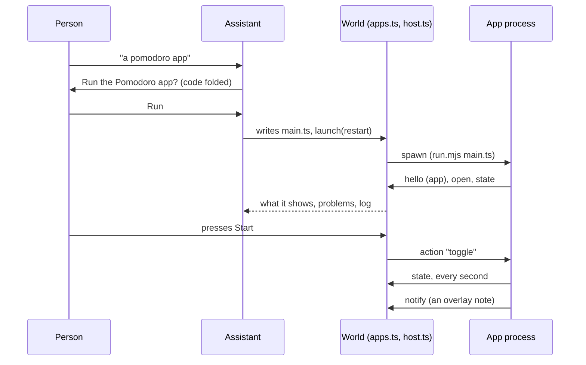

# Generated interfaces: the design

How generated interfaces in Proscenium look, behave and fit together, and why.
[GENUI.md](GENUI.md) is the reference: the protocol, the catalog, the files.
This document is the reasoning behind them.

## The idea

An interface is described, not drawn. A program, or the assistant, sends a
[json-render](https://github.com/vercel-labs/json-render) spec: a flat tree of
components from a fixed catalog, with state, bindings and actions. The world,
the React program that directs the compositor, draws it natively with
`proscenium/ui`, as compositor nodes beside the windows.

Four choices follow from that:

- **Programs own their interfaces; the world draws them.** A program needs no
  Wayland surface, buffer or toolkit. It sends JSON over a Unix socket and hears
  back what the person does. Its interfaces close when it disconnects.
- **The person decides where things live.** Every interface can be dragged
  between modes: in the chat, floating, pinned over everything, docked, on the
  canvas. The program is told, and doesn't get to move it back by accident.
- **Nothing generated costs anything while it is still.** Looks animate in the
  compositor, state changes redraw only what changed, and nothing loops except
  while work is under way.
- **Logic lives in programs, not in the world.** An interface's spec handles
  what it can by itself (tabs, toggles, lists). Anything more belongs to the
  program that owns it, which can be an app: a process the world starts and
  keeps running, which the assistant can write.



## Who owns what

| Part | Owner | Notes |
| --- | --- | --- |
| Spec (elements) | The program | The world draws its copy; only the program changes it. |
| State | Shared | The world's copy is live. The program sets it; the person changes it through inputs; the renderer keeps its own under `/_ui`. |
| Mode and place | Shared | The program picks it when the interface is new and may `place` it later; the person drags it. The last move wins, and the program hears about the person's. |
| Chat transcript | The assistant | The world draws its copy. |
| Chat open, composer draft | The world | Saved with the world's persistent state. |
| An app's code | Its folder | The person's, or written by the assistant once the person allows it. |
| Whether an app runs | The world | Started, stopped and restarted by the world, saved in `running.json`. |
| An app's data | The app | Kept in its state folder, with where the person put its interfaces. |

What makes this hold up:

- **Replay in order.** A program keeps each interface as the spec it opened
  with plus a log of every change since, its own and the person's, in the
  order they happened. A world that reloads gets them again in that order, so
  the latest change wins whoever made it. The log merges consecutive state
  changes and folds itself into the world's copy past 48 entries.
- **Element state in the interface's state.** An input the spec binds to
  nothing, and a countdown's clock, live under `/_ui/<element>/…`. So they
  survive moving between modes (which draws the card anew) and reloads, and
  the owner sees them in its actions.
- **Edits don't move.** Opening an interface that is open changes it where it
  is. Only `place`, or the person, moves it.
- **One assistant.** A newer one takes the chat; the older is told to stop and
  does. The world restarts the built-in assistant after a crash, with backoff,
  and starts it whenever the chat is open with no assistant.
- **Restarts.** The assistant saves its transcript, its interfaces and its Pi
  session, and restores them when it starts again. Programs started outside the
  session reconnect by themselves. Apps that were running start again with the
  world.

## Modes

| Mode | Where | Frame | Width | Use for |
| --- | --- | --- | --- | --- |
| Inline | In the chat message that made it | Slim | The chat's | Answers, forms, approvals |
| Floating | Anywhere on the screen | Full | 360 | Something to keep at hand |
| Overlay | A corner or edge, over everything | Slim | 300 | Timers, monitors, notes |
| Dock | Along the left or right edge | Full, stacked | 320 | Panels to work beside; windows make room |
| Canvas | In the world, with the windows | Full | 380 | Things that belong to a place on the canvas |
| Dialog | Centred over a dimmed screen | Full | 420 | Questions that need an answer |

Placement rules:

- Overlays sit in the space docks and the chat leave clear, so a monitor pinned
  top-right never covers the chat's header.
- The chat (420 wide, below the bar, 12 from the edges) moves left of a
  right-hand dock.
- Docks reserve their width with `<Reserve>`, so tiling worlds lay windows out
  around them.
- A dialog's backdrop takes presses, so nothing else can be clicked until it is
  answered; several dialogs stack in a column.
- Positions are whole pixels wherever they come from.

### Moving between modes

Drag any card by its title bar. A live copy lifts under the pointer, the card
it came from fades to 30%, and the place it would land lights up:

```
┌──────────────────────────────────────────────────────────────┐
│ ┌─corner─┐                                       ┌─corner─┐ │
│ │ pin    │                                       │ pin    │ │
│ └────────┘                                       └────────┘ │
│e                                                    ┌──────┐e│
│d              (anywhere else: float here)           │ chat │d│
│g                                                    │ back │g│
│e                                                    │ to it│e│
│ ┌─corner─┐          ┌──Pin to canvas──┐ ┌─corner─┐  └──────┘ │
└──────────────────────────────────────────────────────────────┘
```

- The outer 30 px of each side docks it.
- The 110 px corners of the clear area pin it over everything.
- The chat takes back interfaces that came from it.
- "Pin to canvas", at the bottom centre, leaves it in the world, kept in view.
- Anywhere else floats it where it was let go.

The copy hands its on-screen place to the card where it lands (`layoutId`),
so the card glides from the drop point rather than jumping. A card that moves
is drawn anew, so the copy's identity takes over cleanly. In the chat, a card
that moved out leaves a note with "Bring back".

## The frame

Every interface sits in the same frame, so generated content never has to draw
its own chrome:

- **Full bar** (34 px): the title in strong text, the owner's name after it in
  faint text on the same line (one Text node, so they share a baseline), and a
  close mark.
- **Slim bar** (28 px, inline and overlay): the title in a 12 px muted label,
  and the close mark.
- **Insets.** The title starts 14 px in, where the content starts, and the
  close mark's glyph ends 14 px from the right edge, where the content ends.
  Content has 14 px on both sides and below.
- **Fill.** White, or #26262b for dark interfaces. It is opaque, so whatever is
  behind never shows through.
- **Root card.** A `Card` at the spec's root draws no card of its own, since
  the frame already is one.
- **Height.** The frame is as tall as its interface, up to the room its mode
  leaves: the screen's height less the card's place for a floating card, the
  screen's for overlays, docks and dialogs, none for canvas cards. Past that
  the content scrolls inside the frame, by the wheel, in whole pixels, with a
  thin thumb at the right edge saying there is more. A commit review an agent
  wrote ran to 1,400 px on a 720 px screen; its buttons are a scroll away
  rather than off the screen.

## The visual system

**Space.** 14 px inside and around cards, the frame and the chat. 8 px between
things in a row and between a card's children. 6 px between a label and its
control. List rows get 5 px above and below whatever they hold. A
`ListItem`'s highlight reaches 6 px past the content edge, so its words line up
with everything else.

**Type** (Noto Sans):

| Role | Size | Weight |
| --- | --- | --- |
| Heading 1 / 2 / 3 | 22 / 17 / 14 | 700 / 700 / 650 |
| Card and frame titles | 15 / 13 | 650 |
| Body, values beside labels | 13 | 500 |
| Labels (fields, metrics, table heads, chart values) | 12 | 600, muted |
| Badges | 11 | 650 |
| Metric value | 26 | 700 |
| Code, clocks | 12, and 18–46 for countdowns | Noto Sans Mono |

Text that shares a row with other text is the same size (a slider's label and
value), or part of the same Text node (a metric's number and unit), so
baselines line up.

**Colour.** Everything comes from the `proscenium/ui` theme: ink, soft, muted
and faint text, the accent, hover and press fills. Tones add success
(#16a34a, #4ade80 on dark) and warning (#d97706, #fbbf24 on dark). Interfaces
choose light or dark; `Card` with `variant: "ink"` puts its contents in the
dark theme.

**Motion.** One-shot springs from the theme: `pop` (0.26 s) for presses and
hovers, `glide` (0.34 s) for things that move, a 0.4 s slide for the chat, and
a 0.28 s critically damped spring for scrolling. Only an unknown-length
progress bar and the chat's typing dots loop, and only while they show.

### Sharp text

The compositor draws a text node's raster exactly where the node is. So:

- **Text sits on whole pixels.** It is aligned by layout (Yoga rounds to whole
  pixels), never by Pango inside a box: right-aligned numbers sit in a box
  justified to the end, and centred labels are centred by their parent. Pango
  aligns only the lines of long text that wraps.
- **Offsets are rounded.** Scroll offsets, drop positions and positions
  programs give are rounded too, and the caret is moved by whole pixels.
- **Measured.** A half-pixel vertical offset costs a quarter of a line's sharp
  strokes, and a horizontal one about half.

## Components

The catalog is small on purpose: 30 components a model can combine reliably.
Notes on the ones with design decisions in them:

- **Stack, Card, Grid, List.** Columns stretch their children; rows centre
  them. `Grid` makes equal cells. `List` puts hairlines between rows.
- **Button.** As wide as its label in a row or a column; `block: true` fills
  the width. Variants: plain, tinted, filled, danger.
- **Metric.** A 12 px label, then the value and its unit on one line, the unit
  at 14 px muted, then an optional delta (▲ green, ▼ red) and caption.
- **BarChart.** Horizontal bars with labels at 28% of the width and values in a
  64 px column, right-aligned by layout. Vertical columns take a height.
- **Sparkline.** Columns filling whatever width it gets, the latest one solid, scaled to the series or to a fixed `min` and `max` (0 and 100 for a percentage).
- **Countdown.** Its clock lives in the interface's state, so it keeps running
  wherever the card goes. `running` is meant to be bound to state, so Start and
  Pause are `setState` buttons. `resetTimer` puts it back to its seconds,
  stopped, setting the bound running to false. It wakes once a second while
  running.
- **Inputs** (`TextField`, `Switch`, `Checkbox`, `Slider`, `Tabs`). Bound with
  `$bindState` to paths the spec names, or kept under `/_ui` when bound to
  nothing.
- **Image.** Takes a path, or an https URL fetched once into a cache.
- **Diff.** Rows of 11 px mono: the old and new line numbers in a faint
  gutter, a red − or green +, and the line, which wraps (up to four lines)
  rather than running off. Removed and added rows are tinted with the danger
  and success colors. Runs of unchanged lines fold to "⋯ 12 unchanged lines",
  followed by the function a unified diff names. Each file has a header with
  its path and +/− counts. Given `before` and `after` it works out the lines
  itself: shared ends trimmed, then the longest common run of what is left.
  Removals come before additions, as git shows them. A patch whose chunks
  carry no numbers (Codex's) gets no gutter, rather than invented numbers.
- **Choices.** Rows with a 1 px line that turns accent, with a soft accent
  fill, when chosen. A radio dot, or a checkbox tick with `multiple`. The
  label is strong, the description muted beneath it, and an optional badge
  ("Recommended") sits at the right. It is for questions; `Tabs` stays the
  short switch.
- **Steps.** A timeline: an 18 px mark per item, with a line down to the next
  that turns green below done items.
  - Done is a green disc with a tick.
  - Active is an accent ring around a breathing dot, its title strong in ink,
    and its detail shown.
  - Pending is an empty ring.
  - Failed is a red disc with a cross, and its detail in red.
  - Skipped is a faint ring with a bar.

  The statuses agents write (`in_progress`, `completed`, `cancelled`) map onto
  these.
- **Failures.** An element that fails to draw shows why inside its own
  interface; an unknown type shows its name.

## The text field

`proscenium/ui`'s `TextField` is drawn by the world, not a client:

- **Focus.** Focused, it holds the keyboard with `useKeyboardGrab`: keys come
  to it, and windows lose keyboard focus meanwhile. One field is focused at a
  time. A press anywhere else, Escape, or the field going away lets go.
- **Caret.** A second, all-but-clear copy of the text lies over the first with
  a caret glyph inserted at the caret, wrapped between word joiners. Pango wraps
  both copies alike, so the caret lands where the text is on any line, without
  measuring anything. Its colour is `#00000001`, because the compositor skips
  text that is wholly clear.
- **Selection** is the same text with a highlighted span.
- **Keys:**
  - Arrows move by characters, and by words with Ctrl.
  - Home and End go to the line's ends, and to the text's with Ctrl.
  - Shift extends the selection; Ctrl+A selects all.
  - Ctrl+C, X and V copy, cut and paste.
  - Backspace and Delete remove characters, or words with Ctrl.
  - Return submits; Shift+Return adds a line in multiline fields.
- **Not supported yet:** a press doesn't place the caret (it goes to the end),
  and there's no input method for composed characters.
- **Wobble.** Typing made the text wobble by fractions of a pixel. That comes
  from the compositor, not the field: see Known limits.

## The chat

A 420 px panel below the bar at the right of the screen, opened with Super+A.

- **Header.** A sparkle, "Assistant" and the model's name on one line, plus New
  chat and close.
- **Messages:**
  - The person's: accent bubbles on the right.
  - The assistant's: its parts in order. Text is Markdown; tools show as small
    pills with a pulsing icon while they run and ✓ or ! after; an interface
    shows in place; one that moved out shows a note with "Bring back"; the last
    line of its thinking shows faintly while it is the newest thing.
  - Events, such as "Sent from Trip planner": centred, faint.
- **Scrolling.** The view keeps the newest message in sight while you're at
  the bottom; scrolling up stays put.
- **Composer.** A multiline field, plus a send button of the same height that
  becomes Stop while the assistant works. A message typed while it works waits
  in line. The draft is kept if the chat is put away or the world reloads.
- **First use.** With no messages: "What can I make you?" and three
  suggestions that send themselves.

## The assistant

A Pi agent in its own process, a client of the same socket as any program:

- **Tools.** `ui_render` writes interfaces as json-render patches. Pi streams
  a tool call's arguments as the model writes them, so each patch goes to the
  world as soon as the next begins, and the interface builds up as it's
  written. The id, mode and title are trusted only once the patches have begun,
  since half-written strings look like whole ones. `ui_place`, `ui_close`,
  `ui_read` and `ui_feed` work on interfaces it made; read, ls, grep, find and
  bash let it find real data.
- **Fixing its own work.** `ui_render` answers with what is wrong with the spec
  (missing children, unknown components, fields in the wrong place). When
  something is, the answer says it isn't finished and asks for a fix before
  replying. A model that skipped elements then adds them instead of giving up.
- **Approvals.** Every shell command waits on a card: Run, Allow all in this
  chat, or Don't run. Closing the card, or Stop, is Don't run. The card stays as
  a record of what was decided.
- **Round trips.** A button bound to `ask` sends the interface's whole state
  back as a message. The chat shows only where it came from; the model acts and
  usually patches the same interface.
- **Prompt.** A short one about the desktop, the modes and real data, followed
  by json-render's own catalog prompt adapted to the tool.

## Apps

Some interfaces need logic: a timer that alerts when it's done and survives a
restart, a pomodoro that counts rounds, a tracker that saves entries, a game.
A spec can't hold that, and running it through the assistant would put a
model in every button press. An app holds it: a small program that owns its
interfaces and runs everything behind them.



- **A process of its own.** The world starts it with `run.mjs`, which bundles
  `main.ts` and resolves the app library. As a process it can crash, run a
  bad loop or block without touching the desktop, and it can do anything a
  program does: keep time, save files, run commands, fetch.
- **Owned, not shared.** An app's interfaces are its own, keyed to its
  connection like any program's. The assistant can't patch them. It changes an
  app by writing its code again, which restarts it. So an app keeps working
  with no model in the loop: after the chat is reset, with the assistant
  stopped, or after a restart.
- **The world supervises.** It starts apps, restarts crashed ones (after 1, 2,
  4 and 8 s, left stopped after five quick crashes in a row) and brings
  running ones back with the compositor. An app that ends by itself, as when
  the person closes its last interface, stays stopped. Starting an app that
  runs asks it to show itself again, which is how a timer counting in the
  background gets its card back.
- **Ending when it is closed.** An app quits once it shows nothing, so
  closing what the person sees is how they're done with it. An alert it shows
  counts: a timer that ran out with its card closed quits when the alert goes.
  An app with work left (a timer still counting) sets `background` and stays.
- **One library.** `proscenium-app` is a thin layer over the client: a view per
  interface with handlers by action name, state kept in step with the
  person's, `notify`, `load` and `save`. The assistant's prompt teaches it in a
  dozen lines.
- **Allowed once, like a command.** An app is code that runs on the person's
  machine. Before it runs, the person sees its description, where it lives,
  its length and, under Show the code, the code itself. Allow all in this chat
  covers apps too.
- **Checked like a spec.** The launch waits until the app's interfaces are
  still, then reports what it shows, what's wrong with each spec and its log
  (errors name lines of `main.ts`). The model writes the app again until it's
  clean. The checks include values the spec reads from state that the state
  lacks, which would show as nothing: the mistake the first apps the
  assistant wrote made most.
- **The chat keeps a chip.** The app isn't in the chat, but the message that
  made it says whether it runs, with Stop or Start, and Open for one running
  with nothing open.

`examples/genui/apps/timer` is the reference app: presets, start and pause,
a minute more, reset, an alert over everything when the time is up, counting
on with its card closed, and the time kept across restarts, in about 140 lines.

## Coding agents

The person runs Claude Code or Codex in a terminal and looks elsewhere. When
the agent needs them, the question should come to where they are. What we
built, and why:

- **Hooks, not wrappers.** Both agents have hooks: a command run at each
  moment (a prompt, a tool, a permission, the end of a turn), given the event
  as JSON, whose output can decide a permission. Claude can also answer its
  own questions (`AskUserQuestion`) through `updatedInput.answers`. Wrapping
  the agent's terminal or its API would have meant parsing a TUI. With hooks,
  the agent stays exactly as it is, and the terminal stays a place to answer
  too.
- **One app for every agent.** Hooks are short-lived and can't own a card
  that outlives them, and a panel of sessions needs one owner anyway. So the
  hooks `tell` the Agents app, which the world starts on the first message
  and keeps running while anything waits. A request whose hook is killed (the
  person answered in the terminal, or pressed Esc) is taken back (`untold`),
  and its card closes. An app that crashes with a question open gets the
  question again from the world once restarted.
- **Fast hooks.** Claude runs one before every tool. `hook.mjs` is plain
  JavaScript that writes two lines to the socket and exits (about 40 ms of node
  start), instead of a bundled TypeScript program.
- **Cards say what will happen, the way the person checks it.** A command
  shows as code with the agent's own description of it. An edit shows as a
  diff around the change, numbered as in the file, because "Edit report.mjs?"
  alone can't be judged. A long command shows its first lines and "N more
  lines", so the buttons stay on the screen. Deny takes words: what the agent
  should do instead goes back with the denial, as in the terminal.
- **No asking to ask.** The MCP server's tools only show things on the
  person's screen, so the Agents app allows them without a card. Otherwise
  every question came with a question about asking it.
- **Agents make their own interfaces.** `show_interface` puts the catalog in
  agents' hands. Asked to "show me the diff and your commit message, let me
  edit it, commit once I approve", Claude Code built a review card: a heading,
  a summary, a multi-file `Diff` of `git diff`, the message in a multiline
  field, and Cancel and Approve & commit. It then waited on it. The
  interfaces belong to the MCP server, so they go when the session ends.
- **Tried for real.** Both agents did one errand in a small invoice CLI: add
  machine-readable output for an accounting import, asking first. Claude Code
  asked two questions (formats, multiple choice; contents, one), edited two
  files, appended tests with a heredoc, ran them and built its commit review.
  Codex asked through `ask_person`, took "CSV" plus a written note, and asked
  to apply its patch across four files. The panel followed both throughout.
  Neither used a task-list tool on this errand, so the plan view has only seen
  test events so far.

## Live data

Some interfaces show things that change by themselves: a system monitor, a
download, a build. Two ways to keep them current, both through state updates
(changing values re-renders that one interface and commits only what changed):

**From any program.** Open once, then push values. As an app:

```ts
const ui = app();
const view = ui.open("system", { mode: "overlay", place: { anchor: "top-right" }, title: "System", spec });
setInterval(() => view.set({ cpu: load(), memory: memory() }), 2000);
```

`examples/genui/apps/monitor` is the whole thing in 80 lines, and
`proscenium-ui start monitor` runs it. From a language without the client, it's
the same two JSON messages over the socket.

**From the assistant.** `ui_feed` gives an interface a feed: a shell command
run every few seconds whose output goes into the interface's state, after the
assistant has answered.

- **Output format.** The simplest is one `name value` pair per line (into
  `"/"`), which fills `/name` for each line without any JSON quoting. A feed can
  also print a number, text, JSON or lines, and `keep: N` turns one path into a
  rolling list for a Sparkline.
- **Approval.** You allow the command once, like any other.
- **Failures.** The first run happens at once and is returned to the model; a
  command that fails then isn't started, so the model fixes it. A feed that
  later fails three times in a row stops, and the chat says why.
- **Lifetime.** Feeds end when their interface closes, are saved with the chat,
  and start again with the assistant.

Asked for "my CPU load and memory use, updating every 2 seconds, pinned in the
top right corner", the assistant writes the card, pins it, and feeds it from one
`printf`/`awk` command.

## Cost

Measured on the headless rig:

- With the gallery open and a pan, every frame matched a full redraw.
- Idle interfaces do nothing.
- A running countdown wakes once a second.
- A feed costs a shell run per tick in the assistant's process, plus a state
  update for one interface.
- An app costs a Node process, about 70 MB resident, and whatever it does.
  The timer sends one state change a second while it counts and nothing
  otherwise.
- The chat streams at most 25 updates a second and skips ones that change
  nothing shown.

## Known limits

- **The compositor squeezes text rasters.** A text raster is a whole number of
  pixels, but it is drawn into the text's fractional-size box (`src/media.c`
  `media_text_raster_box`). As text changes width while typing, the glyphs
  shift by fractions of a pixel: the wobble. All text is also a little soft.
  Snapping the raster box to whole device pixels fixes both. It's measured in a
  throwaway build: the glyphs never move while typing, plain text has 2.6× as
  many fully sharp stroke pixels, and frames still match full redraws. It's a
  change to C, waiting for a go-ahead.
- **Canvas mode follows the camera.** Cards pinned to the canvas are as sharp
  as the camera's position allows; after a fling it can rest between pixels,
  which softens windows too.
- **First output only.** Interfaces show on the first output.
- **Cards can't sit beside the agent's terminal.** The world isn't told which
  process owns a window, so an agent's cards go to the top right corner rather
  than next to its terminal. Knowing each window's client pid (a small change
  in C) would let the Agents app put them beside the window whose process
  started the agent.
- **A multiline field doesn't grow.** A commit message longer than the field
  is cut at its bottom edge rather than scrolling inside it.
- **Apps run as the person.** An app the person allowed can do whatever they
  can. There's no sandbox, the same as for commands.
- **Model reliability.** Codex Luna 6 at a low thinking level sometimes drops
  elements or fumbles deeply nested patches. The tool's feedback catches
  missing pieces; `PROSCENIUM_ASSISTANT_THINKING=medium` trades speed for fewer
  repairs.
