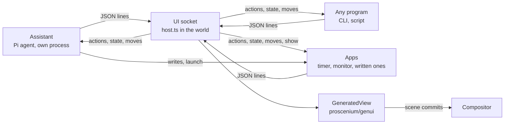

# Generated interfaces

Programs and models can put interfaces on the desktop by describing them, not
drawing them. An interface is a [json-render](https://github.com/vercel-labs/json-render)
spec: a flat tree of components from a catalog, with state, bindings and
actions. The world draws it natively with `proscenium/ui`, as compositor nodes,
so a program that wants a card on the screen needs no Wayland surface, no
buffer and no toolkit. It sends JSON over a socket and hears back what the
person does.

The assistant is the first such program: a [Pi](https://pi.dev) agent that
chats in a panel drawn by the world (Super+A) and makes interfaces as it
answers, which the person can then drag anywhere.

An app is a program that owns its interfaces and runs all of their logic. It
is kept in an apps folder, and the world starts it as a process of its own,
restarts it if it crashes, and brings it back after a restart. The assistant
can write one (a pomodoro, a tracker that saves) and leave it running apart
from the chat, the person can start one from the shell, and anyone can write
one by hand with the app library.

[GENUI-DESIGN.md](GENUI-DESIGN.md) goes over the design: modes, the frame, the
visual system, the components, the chat, live data and known limits.



## Pieces

| Where | What |
| --- | --- |
| `sdk/src/genui/` (`proscenium/genui`) | The catalog (`catalog.ts`: components as zod schemas, `catalogPrompt()`), `Surface` (a spec and its state, changed by JSON patches), `GeneratedView` (draws one), Markdown as Pango markup. |
| `sdk/src/ui/` | `TextField`, `ScrollView`, `Checkbox` and `ProgressBar`, added for generated interfaces and the chat. |
| `examples/genui/host.ts` | The world's side of the protocol: the socket, the interfaces programs own, the assistant's chat. |
| `examples/genui/Surfaces.tsx` | Where interfaces show in each mode, and dragging them between modes. |
| `examples/genui/Chat.tsx` | The chat panel. |
| `examples/genui/GenerativeUI.tsx` | All of it as one component; `components/Desktop` mounts it, so every example world has it. |
| `examples/genui/client.ts` | A program's side of the protocol, with no dependencies. |
| `examples/genui/app.ts` | The app library (`proscenium-app`): views with action handlers, state, notes, saved data. |
| `examples/genui/apps.ts` | The world's apps: finding them, starting them as processes, restarting crashed ones, bringing them back after a restart. |
| `examples/genui/apps/` | Apps that ship with Proscenium: `timer` and `monitor`. |
| `examples/genui/agent/` | The assistant. |
| `examples/genui/cli.ts`, `scripts/proscenium-ui` | Interfaces and apps from the shell. |
| `examples/genui/demos/` | `gallery.ts` (every component, every mode). |

## Modes

An interface lives in one mode at a time. Programs choose one when they open
it and can move it later; the person moves it by dragging its title bar.

| Mode | Where | Place |
| --- | --- | --- |
| `inline` | Inside the assistant's chat message that made it. The assistant's only. | — |
| `floating` | A card on the screen. | `x`, `y` in screen pixels |
| `overlay` | A compact card pinned over everything at a corner or edge, clear of docks and the chat. | `anchor`: `top-left`, `top`, `top-right`, `left`, `center`, `right`, `bottom-left`, `bottom`, `bottom-right` |
| `dock` | A panel along an edge. Windows keep clear of it (`<Reserve>`), and the chat moves aside. | `side`: `left`, `right` |
| `canvas` | A card in the world: it pans and zooms with the windows. | `x`, `y` in world units |
| `dialog` | Centred over a dimmed screen that takes no presses until it is answered. | — |

Dragging an interface lifts a live copy of it under the pointer and lights up
where it would land: an edge docks it, a corner pins it over everything, the
chat takes it back (if it came from there), the "Pin to canvas" target leaves
it in the world, and anywhere else floats it. The copy hands its place over to
the card where it lands (`layoutId`), so the card glides from where it was let
go. The chat keeps a note in the message, with Bring back.

## Components

The catalog (`sdk/src/genui/catalog.ts`) is what a model is told about and what
the renderer draws:

- Layout: `Stack`, `Card`, `Grid`, `List`, `Divider`, `Spacer`.
- Content: `Heading`, `Text`, `Markdown`, `Badge`, `Metric`, `KeyValue`, `ListItem`, `Table`, `Code`, `Avatar`, `Image` (a file path or an https URL, fetched once).
- Charts: `BarChart` (horizontal or vertical), `Sparkline`, `ProgressBar`.
- Input: `Button` (as wide as its label, or `block`), `TextField`, `Switch`, `Checkbox`, `Slider`, `Tabs`.
- Live: `Countdown`, whose clock is kept in the interface's state so it runs on wherever the interface moves.

Everything json-render specs can say works: `$state`, `$bindState`, `$item`,
`$bindItem`, `$index`, `$cond`, `$template`, `visible` conditions, `repeat`,
`watch`, and `on` bindings. `setState`, `pushState` and `removeState` run in the
world; `close` closes the interface, `copy` puts `text` on the clipboard, and
`resetTimer` puts a countdown back to its seconds, stopped; every other action
goes to the program that owns the interface, with the interface's whole state.

A root `Card` draws no card of its own, as the frame around the interface is
one. An element that fails to draw shows why inside its own interface.

## Protocol

The world listens on `$PROSCENIUM_UI_SOCKET`, else
`$XDG_RUNTIME_DIR/proscenium-ui.sock`. Each message is one JSON object on a
line; `protocol.ts` has the types. Ids are a program's own: two programs can
both have an interface called `main`.

Program to world:

| `op` | Fields | |
| --- | --- | --- |
| `hello` | `name`, `app?`, `pid?` | Who it is, shown on its title bars, and the app it is (`$PROSCENIUM_APP`). |
| `open` | `id`, `mode?`, `place?`, `title?`, `width?`, `theme?` (`light`, `dark`), `spec?`, `patches?`, `request?` | Opens interface `id`, or changes it if it is open. |
| `patch` | `id`, `patches`, `request?` | json-render patches (RFC 6902, paths under `/root`, `/elements`, `/state`). |
| `state` | `id`, `set` | Values by JSON pointer: `{"/load": 0.4}`. The cheapest change: no layout is redone that the values do not touch. |
| `update` | `id`, `title?`, `width?`, `theme?`, `message?` | `message: null` unlinks the assistant's interface from its chat message. |
| `place` | `id`, `mode`, `place?` | Moves it. |
| `close` | `id` | |
| `get` | `id`, `request` | Answered with its spec and state, mode and place. |
| `catalog` | `request` | Answered with `prompt`: how to write specs for this catalog, for a model. |
| `apps` | `request` | Answered with `apps`: every app, whether it runs, what it shows and what is wrong with each spec. |
| `launch` | `app`, `restart?`, `request` | Starts an app, or starts it again. A running app is sent `show` instead. Answered once its interfaces have been still for 0.6 s, it ended, or 6 s went by, with `app` (as in `apps`) and `log`, the end of its log. |
| `stop` | `app`, `request` | Stops it; it stays stopped. |

A request with `request` is answered by `{"type":"result","request",…}`, with
`problems` for `open` and `patch`: what is wrong with the spec now (a child
that does not exist, an unknown component, `on` inside props).

World to program:

| `type` | Fields | |
| --- | --- | --- |
| `welcome` | `protocol`, `modes`, `screen` | On connecting. |
| `action` | `id`, `action`, `params`, `state`, `seen` | An action the world does not run itself. |
| `state` | `id`, `state`, `seen` | The person changed its state (typed, toggled, dragged), at most every 120 ms. |
| `placed` | `id`, `mode`, `place` | The person moved it. |
| `closed` | `id`, `by` | |
| `show` | | To an app: something started it while it runs; it shows itself (`ui.onShow`). |
| `error` | `message`, `fatal?` | A fatal one ends the connection for good: a newer assistant took the chat. |

A program's interfaces close when its connection does. A world that reloads
starts a new socket; `client.ts` reconnects and opens its interfaces again as
they were, with what the person last changed in them and where they put them.

## Who owns what

| State | Owner | Copies | Changed by |
| --- | --- | --- | --- |
| Spec | The program | The world's `Surface`, which is drawn; the program's replay log | The program |
| State | The world's `Surface` is the live one | The program's replay log, kept current by `state` events | The program (patches, `state`), the person (inputs, `setState`…), the renderer under `/_ui` |
| Mode and place | Both; the last move wins | The world's record; the replay log, kept current by `placed` | The program (`open` of a new interface, `place`), the person (dragging) |
| Title, width, theme | The program | The world's record | The program |
| The chat message an inline interface lives in | The assistant | The world's record | The assistant; New chat unlinks (`message: null`) |
| Chat transcript, busy, model | The assistant | The world's copy, which it draws | The assistant |
| Chat open, composer draft | The world | Its persistent state | The person |
| An app's code and manifest | Its folder | | The person, the assistant (`app_write`) |
| Whether an app runs | The world (`apps.ts`) | `running.json` | Whoever launches or stops it; the app, by ending |
| An app's data, where the person put its interfaces | The app | `data.json`, `places.json` in its state folder | The app (`ui.save`), the person (dragging) |

- **Replay.** `client.ts` keeps each interface as the spec it opened with and a
  log of every change since, in order: its own patches and state, and the
  person's state as the world reports it. A new world gets the spec, then the
  changes in that order, so the latest change wins whoever made it.
  Consecutive state changes merge; past 48 changes the log is folded into the
  world's copy (`get`), so it stays short however long the interface lives.
- **In flight.** `state` in an `action` or `state` event is the world's copy
  after the first `seen` lines the program sent on this connection. The
  client keeps its changes of the last few seconds by line, so it lays the
  ones the world had not seen yet over that copy, in its replay log and in
  what the app library calls the state now.
- **`/_ui`.** The renderer keeps an element's own state inside the interface's:
  an input the spec binds to nothing (`/_ui/<element>/value`), a countdown's
  clock (`/_ui/<element>/clock`). So it survives moves and reloads like any
  other state, and the owner sees it in `state` events and actions. Models are
  told to read it, never write it.
- **Moving.** Opening an interface that is already open changes it where it is;
  only `place` (or the person) moves it.
- **One assistant.** A program saying `hello` with `agent: true` takes the chat;
  the one before is told with a fatal error and its interfaces close. The
  built-in assistant starts whenever the chat is open with no assistant, and
  again after a crash (1 s, doubling to 30 s); one that exits cleanly, stopped
  or replaced, stays stopped.
- **Restarts.** World reload: everything comes back from the programs, and
  running apps keep running and reconnect. Compositor restart: programs
  started outside the session come back by themselves, apps that were running
  start again, and the built-in assistant restores its chat from disk (below).
  `proscenium-ui` waits ten seconds for a world before giving up.

```sh
# A card for ten seconds, from anything that can write to a socket:
{ printf '%s\n' '{"op":"hello","name":"sh"}' \
    '{"op":"open","id":"n","mode":"floating","title":"Hi","spec":{"root":"t","elements":{"t":{"type":"Text","props":{"text":"Hello from a shell script"},"children":[]}}}}'
  sleep 10; } | nc -U "$XDG_RUNTIME_DIR/proscenium-ui.sock"
```

## Apps

An app is a folder: `main.ts` (or `main.js`, `main.mjs`) and an `app.json`
with its `title` and `description`. An app in another language gives a
`command`, `[program, ...args]`, run in its folder. The world looks in two
places, and the person's folder wins over Proscenium's for the same name:

| Folder | |
| --- | --- |
| `$XDG_DATA_HOME/proscenium/apps/NAME/` | The person's, and the ones the assistant writes. |
| `examples/genui/apps/NAME/` | The ones that ship with Proscenium. |

`run.mjs` bundles and runs `main.ts` wherever it is, and resolves
`proscenium-app` to the library:

```ts
import { app } from "proscenium-app";

const ui = app();
const view = ui.open("main", { mode: "floating", title: "Timer", width: 300, spec });
view.on("start", (params) => { /* an element's on.press: { action: "start", params } */ });
view.set({ left: "24:59", running: true });   // or JSON pointers: view.set("/items/0/done", true)
view.state;                                   // the state now, with what the person typed or toggled
view.onChange((state) => {});                 // the person changed state
view.element("label", element); view.patch(patches); view.update({ title }); view.place("overlay"); view.close();
ui.notify("Time's up", { title: "Timer", seconds: 10 });
const data = ui.load({ entries: [] }); ui.save(data);
ui.background = true;                         // keep running with nothing open
ui.onShow(() => {});                          // asked for again while running
```

The world still runs `setState`, `pushState`, `removeState`, `close` and `copy`
itself. Every other action goes to the app's handler for it, with its params
and the interface's state. A handler that throws, or an error later on, goes to
the app's log and the app keeps running. An error while it starts ends it, and
its stack names lines of `main.ts`.

- **Lifetime.** An app runs until it ends or is stopped. By default it ends,
  with exit code 0, once it shows nothing: the person closed its last
  interface, or its last note went. One with `ui.background` set keeps running
  with nothing open: the timer does while it counts, so it still alerts, and
  turning it off with nothing open ends the app. Starting an app that runs
  sends it `show`.
- **Supervision.** Running apps belong to the world's director, each in a
  process group of its own (so a terminal's Ctrl-C reaches only the
  director). They stop with it, and `running.json` starts them again with the
  next one; an app that ends while the director stops is neither stopped nor
  crashed. An app that ends by itself, is stopped (SIGTERM included) or whose
  program can't start stays stopped. One that crashes starts again after 1 s,
  then 2, 4 and 8. After five crashes in a row, each within a minute of
  starting, it is left stopped.
- **State folder.** `$XDG_STATE_HOME/proscenium/apps/NAME/` holds `log`
  (everything the app prints, a `===` line at each start, moved to `log.1`
  past 512 KB, checked at each start and every 30 s while it runs),
  `data.json` (`ui.load`, `ui.save`) and `places.json`. The last records where
  the person last put each interface. It reopens there for as long as the app
  asks for the same mode and place as before.
- **Environment.** `PROSCENIUM_UI_SOCKET`, `PROSCENIUM_APP` (its name),
  `PROSCENIUM_APP_TITLE`, `PROSCENIUM_APP_DIR` and `PROSCENIUM_APP_DATA` (its
  state folder). An app the world started exits when the world's director is
  gone, and the next one starts it again.
- **Checks.** `launch` answers with what is wrong with each of the app's specs:
  missing children, unknown components, and values read from state that its
  state lacks (they would show as nothing).

Writing an app by hand is a folder and two files; `proscenium-ui start NAME`
runs it. `examples/genui/apps/timer/main.ts` is a full one in about 140 lines:
presets, start and pause, a minute more, reset, an alert when the time is up,
counting on after its card is closed, and the time kept across restarts.

## The assistant

`examples/genui/agent/main.ts`, started by the world (through
`examples/genui/run.mjs`, which bundles it with the SDK's esbuild) the first
time the chat opens, and kept across world reloads. It is a client of the same
protocol, which also keeps the chat (`chat`, `message` and `status` ops; the
world sends it `prompt`, `abort` and `reset`).

- **Harness.** Pi's `createAgentSession` (`@earendil-works/pi-coding-agent`),
  with Pi's read, ls, grep and find, its bash behind an approval card, and
  tools of its own: `ui_render`, `ui_place`, `ui_close`, `ui_read`, and
  `ui_feed`, which keeps an interface's state current from a shell command run
  every few seconds after the turn ends (allowed once, stopped with the
  interface, saved with the chat).
- **Apps.** `app_write` saves an app's `main.ts` and `app.json` in the person's
  folder and launches it, or launches it again. The person first allows its
  code on a card with its description, path and length, and the code folded
  under Show the code. `app_control` starts, stops, restarts or deletes one
  (a deleted app's folder and state go to `.trash` in the person's apps
  folder). `app_list` lists
  them, or gives one's `main.ts` path and log. The launch's answer (what it
  shows, each spec's problems, its log) goes back to the model, which writes
  the app again until it is clean. In the chat, the app is a chip saying
  whether it runs, with Stop or Start, and Open while it runs with nothing
  open. Its interfaces are its own: the
  assistant changes them by changing the code, and they stay when the chat is
  reset or the assistant stops.
- **Memory.** `$XDG_STATE_HOME/proscenium/assistant/chat.json` keeps the
  transcript, its interfaces (as the client keeps them, to open again), what
  the person allowed, and the Pi session's file under `sessions/`, which Pi
  reopens: after a restart the chat, its cards and the conversation are back.
  A reply cut off by the restart says so, and approvals that were waiting are
  marked not run. New chat starts a new Pi session.
- **Model.** `$PROSCENIUM_ASSISTANT_MODEL` as `provider/model` with the
  provider's usual key variable (`anthropic/claude-sonnet-5-5` with
  `ANTHROPIC_API_KEY`), else Codex Luna 6 at its priority tier on the ChatGPT
  sign-in Codex keeps (read from `~/.codex/auth.json`, never refreshed here; an
  expired token has Codex renew it). `$PROSCENIUM_ASSISTANT_THINKING` sets the
  thinking level (`low` by default).
- **Streaming.** The model writes interfaces as the `patches` of `ui_render`.
  Pi parses a tool call's arguments as they arrive, so each patch goes to the
  world once the next one has started, and the interface fills in while the
  model writes it. The id, mode and title are read only once the patches have
  begun, as half-written strings would otherwise pass for whole ones.
- **Prompt.** The catalog's own prompt (`catalogPrompt()`, json-render's
  standalone prompt with its output format turned into the tool's), after a
  short one about the desktop, the modes, real data and `ask`.
- **Round trips.** A button bound to `{"action":"ask"}` hands the interface back
  to the assistant: the chat notes where it came from, and the model gets the
  interface's whole state to act on, usually ending in a `ui_render` that
  patches the same interface.
- **Shell.** Each command waits for Run, Allow all in this chat, or Don't run on
  a card in the chat; the card stays as a record of what was decided. Closing
  the card, or Stop, is Don't run.
- `$PROSCENIUM_ASSISTANT_LOG=FILE` logs what Pi says, a line per event.

## From the shell

`scripts/proscenium-ui`:

```sh
proscenium-ui ask "Restart the compositor?" --choices "Not now,Restart"   # prints the choice
proscenium-ui ask "Name the branch" --input --placeholder feature/…        # prints what was typed
proscenium-ui notify "**Build finished** · 214 tests passed" --seconds 5
proscenium-ui show card.json --mode dock --side left                       # prints actions as JSON lines
proscenium-ui catalog > prompt.txt                                         # for a model of your own
proscenium-ui apps                                                         # every app, and which run
proscenium-ui start timer                                                  # says what it shows and what is wrong
proscenium-ui stop timer
proscenium-ui logs timer
```

## Cost

Nothing generated runs while it is still. Hover and press states animate in
the compositor; a `state` op re-renders one interface and commits only the
props that changed; the caret does not blink. A `Countdown` wakes once a
second while it runs, an unknown-length `ProgressBar` breathes while it shows,
and the chat's typing dots move only while a reply is on its way. Frames stay
identical to full redraws (`PROSCENIUM_CHECK=1`: 0 of 134 differed with the
gallery open and a pan).

## Decisions

- **No C.** Programs talk to the world, which already directs the compositor;
  a program's interface is React state in the director, so it costs what any
  other world UI costs. Programs owning scene subtrees directly (several
  directors at once) would need the compositor to accept more connections and
  route events per connection; nothing here needed it.
- **json-render as the format, not its renderer.** `@json-render/core` is plain
  TypeScript: its spec, patches, catalog prompt and the resolution of
  expressions, visibility and actions are used as they are. Its React renderer
  draws the DOM, so `proscenium/genui` draws the same specs with the SDK's
  nodes.
- **A tool, not fenced text.** json-render's chat mode has the model write
  patches in a text fence. A tool keeps prose and interfaces apart, gives the
  model the spec's problems back to fix, and carries the mode and id; Pi
  streams tool arguments, so nothing is lost in progress.
- **Text on whole pixels.** The compositor draws text where its node is, so text
  at a fractional position, or aligned by Pango inside a box, lands between
  pixels and blurs (a half pixel across costs about half its sharp strokes).
  Text is aligned by layout, which rounds to whole pixels; Pango aligns only
  the lines of long text that wraps; scroll offsets and positions programs
  give are rounded. Text that shares a line with other text is part of the
  same Text node (a Metric's unit, the chat's model name), so the two share a
  baseline.
- **One spacing scale.** 14 px inside and around cards, title bars and the chat,
  so titles, content and close marks line up on the same edges; 6 px between a
  label and its control; labels at 12 px; list rows padded alike whatever they
  hold.
- **Apps are processes.** An app could have been a script the world runs
  inside itself, but then a bad loop or a crash would take the desktop with
  it, and every app would need to be trusted as the world is. As a process it
  is just another program of the protocol: it can die, be restarted, be
  stopped, and do anything a program does. The world only supervises it. The
  assistant writes apps rather than running their logic itself, so they keep
  working with no model in the loop.
- **Pi directly, not through the AI SDK.** `@ai-sdk/harness-pi` adapts Pi to
  the AI SDK's harness interface, which would put a layer between the chat and
  Pi's events and needs a sandbox session; the chat needs Pi's events as they
  are.
