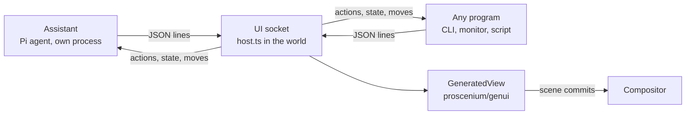

# Generated interfaces

Programs and models can put interfaces on the desktop by describing them, not
drawing them. An interface is a [json-render](https://github.com/vercel-labs/json-render)
spec: a flat tree of components from a catalog, with state, bindings and
actions. The world draws it natively with `proscenium/ui`, as compositor nodes,
so a program that wants a card on the screen needs no Wayland surface, no
buffer and no toolkit. It sends JSON over a socket and hears back what the
person does.

The assistant is the first such program: a [Pi](https://pi.dev) agent that
chats in a panel drawn by the world (Super+A) and makes interfaces as it
answers, which the person can then drag anywhere.



## Pieces

| Where | What |
| --- | --- |
| `sdk/src/genui/` (`proscenium/genui`) | The catalog (`catalog.ts`: components as zod schemas, `catalogPrompt()`), `Surface` (a spec and its state, changed by JSON patches), `GeneratedView` (draws one), Markdown as Pango markup. |
| `sdk/src/ui/` | `TextField`, `ScrollView`, `Checkbox` and `ProgressBar`, added for generated interfaces and the chat. |
| `examples/genui/host.ts` | The world's side of the protocol: the socket, the interfaces programs own, the assistant's chat. |
| `examples/genui/Surfaces.tsx` | Where interfaces show in each mode, and dragging them between modes. |
| `examples/genui/Chat.tsx` | The chat panel. |
| `examples/genui/GenerativeUI.tsx` | All of it as one component; `components/Desktop` mounts it, so every example world has it. |
| `examples/genui/client.ts` | A program's side of the protocol, with no dependencies. |
| `examples/genui/agent/` | The assistant. |
| `examples/genui/cli.ts`, `scripts/proscenium-ui` | Interfaces from the shell. |
| `examples/genui/demos/` | `monitor.ts` (a live system monitor) and `gallery.ts` (every component, every mode). |

## Modes

An interface lives in one mode at a time. Programs choose one when they open
it and can move it later; the person moves it by dragging its title bar.

| Mode | Where | Place |
| --- | --- | --- |
| `inline` | Inside the assistant's chat message that made it. The assistant's only. | — |
| `floating` | A card on the screen. | `x`, `y` in screen pixels |
| `overlay` | A compact card pinned over everything at a corner or edge, clear of docks and the chat. | `anchor`: `top-left`, `top`, `top-right`, `left`, `center`, `right`, `bottom-left`, `bottom`, `bottom-right` |
| `dock` | A panel along an edge. Windows keep clear of it (`<Reserve>`), and the chat moves aside. | `side`: `left`, `right` |
| `canvas` | A card in the world: it pans and zooms with the windows. | `x`, `y` in world units |
| `dialog` | Centred over a dimmed screen that takes no presses until it is answered. | — |

Dragging an interface lifts a live copy of it under the pointer and lights up
where it would land: an edge docks it, a corner pins it over everything, the
chat takes it back (if it came from there), the "Pin to canvas" target leaves
it in the world, and anywhere else floats it. The copy hands its place over to
the card where it lands (`layoutId`), so the card glides from where it was let
go. The chat keeps a note in the message, with Bring back.

## Components

The catalog (`sdk/src/genui/catalog.ts`) is what a model is told about and what
the renderer draws:

- Layout: `Stack`, `Card`, `Grid`, `List`, `Divider`, `Spacer`.
- Content: `Heading`, `Text`, `Markdown`, `Badge`, `Metric`, `KeyValue`, `ListItem`, `Table`, `Code`, `Avatar`, `Image` (a file path or an https URL, fetched once).
- Charts: `BarChart` (horizontal or vertical), `Sparkline`, `ProgressBar`.
- Input: `Button`, `TextField`, `Switch`, `Checkbox`, `Slider`, `Tabs`.
- Live: `Countdown`, whose clock is kept in the interface's state so it runs on wherever the interface moves.

Everything json-render specs can say works: `$state`, `$bindState`, `$item`,
`$bindItem`, `$index`, `$cond`, `$template`, `visible` conditions, `repeat`,
`watch`, and `on` bindings. `setState`, `pushState` and `removeState` run in the
world; `close` closes the interface, `copy` puts `text` on the clipboard, and
every other action goes to the program that owns the interface, with the
interface's whole state.

A root `Card` draws no card of its own, as the frame around the interface is
one. An element that fails to draw shows why inside its own interface.

## Protocol

The world listens on `$PROSCENIUM_UI_SOCKET`, else
`$XDG_RUNTIME_DIR/proscenium-ui.sock`. Each message is one JSON object on a
line; `protocol.ts` has the types. Ids are a program's own: two programs can
both have an interface called `main`.

Program to world:

| `op` | Fields | |
| --- | --- | --- |
| `hello` | `name` | Who it is; shown on its title bars. |
| `open` | `id`, `mode?`, `place?`, `title?`, `width?`, `theme?` (`light`, `dark`), `spec?`, `patches?`, `request?` | Opens interface `id`, or changes it if it is open. |
| `patch` | `id`, `patches`, `request?` | json-render patches (RFC 6902, paths under `/root`, `/elements`, `/state`). |
| `state` | `id`, `set` | Values by JSON pointer: `{"/load": 0.4}`. The cheapest change: no layout is redone that the values do not touch. |
| `update` | `id`, `title?`, `width?`, `theme?` | |
| `place` | `id`, `mode`, `place?` | Moves it. |
| `close` | `id` | |
| `get` | `id`, `request` | Answered with its spec and state, mode and place. |
| `catalog` | `request` | Answered with `prompt`: how to write specs for this catalog, for a model. |

A request with `request` is answered by `{"type":"result","request",…}`, with
`problems` for `open` and `patch`: what is wrong with the spec now (a child
that does not exist, an unknown component, `on` inside props).

World to program:

| `type` | Fields | |
| --- | --- | --- |
| `welcome` | `protocol`, `modes`, `screen` | On connecting. |
| `action` | `id`, `action`, `params`, `state` | An action the world does not run itself. |
| `state` | `id`, `state` | The person changed its state (typed, toggled, dragged), at most every 120 ms. |
| `placed` | `id`, `mode`, `place` | The person moved it. |
| `closed` | `id`, `by` | |

A program's interfaces close when its connection does. A world that reloads
starts a new socket; `client.ts` reconnects and opens its interfaces again as
they were, with what the person last changed in them and where they put them.

```sh
# A card for ten seconds, from anything that can write to a socket:
{ printf '%s\n' '{"op":"hello","name":"sh"}' \
    '{"op":"open","id":"n","mode":"floating","title":"Hi","spec":{"root":"t","elements":{"t":{"type":"Text","props":{"text":"Hello from a shell script"},"children":[]}}}}'
  sleep 10; } | nc -U "$XDG_RUNTIME_DIR/proscenium-ui.sock"
```

## The assistant

`examples/genui/agent/main.ts`, started by the world (through
`examples/genui/run.mjs`, which bundles it with the SDK's esbuild) the first
time the chat opens, and kept across world reloads. It is a client of the same
protocol, which also keeps the chat (`chat`, `message` and `status` ops; the
world sends it `prompt`, `abort` and `reset`).

- **Harness.** Pi's `createAgentSession` (`@earendil-works/pi-coding-agent`),
  in memory, with Pi's read, ls, grep and find, its bash behind an approval card,
  and four tools of its own: `ui_render`, `ui_place`, `ui_close`, `ui_read`.
- **Model.** `$PROSCENIUM_ASSISTANT_MODEL` as `provider/model` with the
  provider's usual key variable (`anthropic/claude-sonnet-5-5` with
  `ANTHROPIC_API_KEY`), else Codex Luna 6 at its priority tier on the ChatGPT
  sign-in Codex keeps (read from `~/.codex/auth.json`, never refreshed here; an
  expired token has Codex renew it). `$PROSCENIUM_ASSISTANT_THINKING` sets the
  thinking level (`low` by default).
- **Streaming.** The model writes interfaces as the `patches` of `ui_render`.
  Pi parses a tool call's arguments as they arrive, so each patch goes to the
  world once the next one has started, and the interface fills in while the
  model writes it. The id, mode and title are read only once the patches have
  begun, as half-written strings would otherwise pass for whole ones.
- **Prompt.** The catalog's own prompt (`catalogPrompt()`, json-render's
  standalone prompt with its output format turned into the tool's), after a
  short one about the desktop, the modes, real data and `ask`.
- **Round trips.** A button bound to `{"action":"ask"}` hands the interface back
  to the assistant: the chat notes where it came from, and the model gets the
  interface's whole state to act on, usually ending in a `ui_render` that
  patches the same interface.
- **Shell.** Each command waits for Run, Allow all in this chat, or Don't run on
  a card in the chat; the card stays as a record of what was decided.
- `$PROSCENIUM_ASSISTANT_LOG=FILE` logs what Pi says, a line per event.

## From the shell

`scripts/proscenium-ui`:

```sh
proscenium-ui ask "Restart the compositor?" --choices "Not now,Restart"   # prints the choice
proscenium-ui ask "Name the branch" --input --placeholder feature/…        # prints what was typed
proscenium-ui notify "**Build finished** · 214 tests passed" --seconds 5
proscenium-ui show card.json --mode dock --side left                       # prints actions as JSON lines
proscenium-ui catalog > prompt.txt                                         # for a model of your own
```

## Cost

Nothing generated runs while it is still. Hover and press states animate in
the compositor; a `state` op re-renders one interface and commits only the
props that changed; the caret does not blink. A `Countdown` wakes once a
second while it runs, an unknown-length `ProgressBar` breathes while it shows,
and the chat's typing dots move only while a reply is on its way. Frames stay
identical to full redraws (`PROSCENIUM_CHECK=1`: 0 of 134 differed with the
gallery open and a pan).

## Decisions

- **No C.** Programs talk to the world, which already directs the compositor;
  a program's interface is React state in the director, so it costs what any
  other world UI costs. Programs owning scene subtrees directly (several
  directors at once) would need the compositor to accept more connections and
  route events per connection; nothing here needed it.
- **json-render as the format, not its renderer.** `@json-render/core` is plain
  TypeScript: its spec, patches, catalog prompt and the resolution of
  expressions, visibility and actions are used as they are. Its React renderer
  draws the DOM, so `proscenium/genui` draws the same specs with the SDK's
  nodes.
- **A tool, not fenced text.** json-render's chat mode has the model write
  patches in a text fence. A tool keeps prose and interfaces apart, gives the
  model the spec's problems back to fix, and carries the mode and id; Pi
  streams tool arguments, so nothing is lost in progress.
- **Pi directly, not through the AI SDK.** `@ai-sdk/harness-pi` adapts Pi to
  the AI SDK's harness interface, which would put a layer between the chat and
  Pi's events and needs a sandbox session; the chat needs Pi's events as they
  are.
