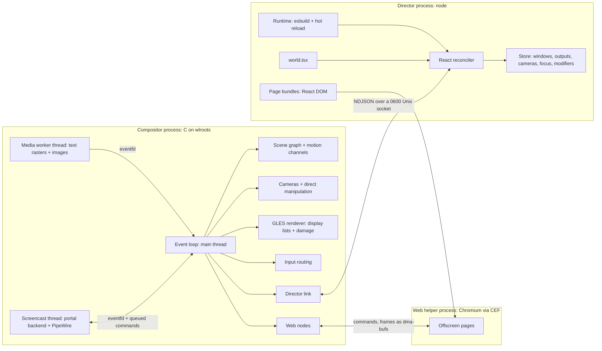

# Writing worlds

Proscenium is a Wayland compositor whose scene is written in TypeScript with
React. A *director* process renders a world's components, such as `<Camera>`,
`<Window>`, `<Text>` and `<Web>`; the compositor keeps the resulting scene
graph, animates it on its own frame clock, renders it with GLES and routes
input. Edit the world file while it runs and the director reloads it: windows
glide from where they are to where the new code puts them.

It is the same idea as [ink](https://github.com/vadimdemedes/ink): a custom
React renderer whose host elements are not DOM nodes but, here, compositor scene
nodes. React DOM still has a place: a `<Web>` node shows a React DOM page,
rendered by Chromium, inside the scene.

Proscenium grew from the Stage World of [Ataxia](../../ataxia/docs/STAGE-WORLD.md),
built directly in C on wlroots 0.20.

```tsx
import { Background, Camera, Window, scale, spring, useWindows } from "proscenium";

export default function World() {
  const windows = useWindows();
  return (
    <>
      <Camera x={0} y={0} zoom={1} transition={spring()} />
      <Background fill="#ecebe6" grid={{ kind: "dots", color: "#0003", spacing: 28 }} pan />
      {windows.map((window, index) => (
        <Window key={window.id} window={window.id} x={-600 + index * 640} y={-300}
                width={600} height={420} radius={10} shadow={{ blur: 32, y: 12, color: "#0003" }}
                movable resizable initial={{ opacity: 0, transform: scale(0.94) }}
                exit={{ opacity: 0, transform: scale(0.94) }}
                transition={spring({ duration: 0.4 })} />
      ))}
    </>
  );
}
```

## Build and run

```sh
meson setup build/meson               # PKG_CONFIG_PATH must find wlroots-0.20
ninja -C build/meson
(cd sdk && npm ci && npm run build)   # Node 22+
build/meson/proscenium --script examples/hypr.tsx
```

The [README](../README.md#build) lists the libraries the build needs and how to
build the Chromium helper that web nodes use. The compositor runs nested in a
session or on a tty; `--headless --size 1280x720` runs it without a display, and
`scripts/run-session WORLD.tsx` makes it the desktop on this seat, as a systemd
user unit logging to `$XDG_STATE_HOME/proscenium/run.log`.

The compositor starts XWayland, then the director on `--script`
(`node sdk/bin/proscenium.mjs WORLD.tsx`). Worlds draw their own bar in TSX. Seven examples ship with it, organized as ordinary React
apps:

- [`canvas.tsx`](../examples/canvas.tsx): an infinite canvas with
  momentum panning, anchored zoom, native window moves and resizes, keyboard
  fly-to, an overview and a minimap.
- [`hypr.tsx`](../examples/hypr.tsx): a Hyprland-style tiler with nine
  workspaces that slide, dwindle and master layouts with gaps, a spinning
  gradient border on the focused window, dimmed inactive windows, floating,
  fullscreen, a scratchpad, focus-follows-mouse, three-finger workspace swipes,
  windows that burn in and out through a shader, a nudge when a move has nowhere
  to go, and workspaces in the bar. Its state is one reducer
  ([`hypr/state.ts`](../examples/hypr/state.ts)) that
  [`HyprProvider`](../examples/hypr/HyprProvider.tsx) shares through context.
- [`niri.tsx`](../examples/niri.tsx): niri, after its source and defaults:
  columns on an endless horizontal strip per workspace, workspaces stacked per
  output, its view-fitting, consume/expel, tabbed columns, presets, floating
  windows and dialogs, the zoomed-out overview (Super+O, the top left corner or
  a four-finger swipe), three-finger swipes that carry their momentum, Super-drag
  moves with an insert hint, the Important Hotkeys overlay, the exit dialog, the
  screenshot UI and the Alt-Tab switcher with live previews, all with niri's
  springs and bindings. Its state is one reducer
  ([`niri/state.ts`](../examples/niri/state.ts)) mirroring niri's layout code.
- [`meta.tsx`](../examples/meta.tsx): Metaworld, an infinite
  canvas of screen-sized rooms placed anywhere, each running another world's
  window management: hypr's tiling, niri's scrolling columns or the deck's hand
  of cards (Super+Shift+T changes it). A room runs that world's own reducer and
  layout code on itself as if it were an output, and takes that world's keys
  ([`meta/worlds.ts`](../examples/meta/worlds.ts)).
  The canvas pans and zooms freely, and windows on it take input in place.
  Double-click empty canvas to make a room, click a room's title to fly in at
  100%, drag the title to put the room anywhere (it follows the pointer in the
  same frame), or Super-drag a window into another room (onto empty canvas, it
  gets a room of its own). Inside, keyboard focus and moves carry on into the
  nearest room past an edge, three-finger swipes slide between rooms, and
  pinching out returns to where the canvas was left. Its state is one reducer
  ([`meta/state.ts`](../examples/meta/state.ts)), holding each room's world's.
- [`deck.tsx`](../examples/deck.tsx): windows as a hand of cards, after
  Balatro. The window in play fills the table; the others fan out along the
  bottom, and the card under the pointer rises, pops and leans toward it in 3D
  while its foil catches the light. Super+Tab deals every window across a
  swirling table as a switcher, most recently played first: Tab moves the
  choice, letting go of Super plays it. Every window keeps the table's size, so
  a card is the live window scaled and turned with `transform`, and clients never
  resize. Closed windows burn away.
- [`cube.tsx`](../examples/cube.tsx): four workspaces on the sides of a
  cube, after Compiz. Super+Left/Right (or Super+wheel, a three-finger swipe,
  Super+1..4) turns it: the cube steps back, swings round in perspective with
  every window live, and comes forward again, faces darkening as they turn away.
  Faces have `backface="hidden"`, so at rest only the one in front is drawn and
  the cube costs what a flat desktop does.
- [`shelf.tsx`](../examples/shelf.tsx): windows as books on a shelf. The
  open window lies over the reading area; the rest stand spine out on a plank,
  each a 3D box built round its live window: a cloth spine lettered with the
  title, the back cover and the pages' top edge, with only faces turned toward
  the eye drawn. Hovering a spine pulls the book out; clicking it, or letting go
  of Super after Super+Tab, swings it open round its spine.

They are laid out like a small React app, formatted with Prettier:
[`components/`](../examples/components) holds what they share (the bar and
its menus, media keys, screen sharing, screenshots on Print and Shift+Print, the
application launcher), [`hooks/`](../examples/hooks) and
[`lib/`](../examples/lib) the hooks, geometry, theme and settings, and
[`pages/`](../examples/pages) the React DOM pages they show.

Without `--script` only the compositor starts, showing every window in its
fallback layout. It prints the socket it listens on (`PROSCENIUM_SOCKET=...`)
when it starts; run a director on it yourself, e.g. under a debugger:

```sh
node sdk/bin/proscenium.mjs --socket "$PROSCENIUM_SOCKET" my-world.tsx
```

`--once` loads the world without watching it, and `--dev` selects React's
development build for detailed component errors and connects to React DevTools
(`npx react-devtools`), which shows the world's components, props and hooks
live; the compositor passes both on to the director it starts. `--socket PATH`,
`--no-xwayland`, `--no-screen-sharing`, `--run-for SECONDS` and `--damage-debug`
also apply; `proscenium --help` lists them.

## Architecture



The compositor is one process. Its main thread runs the Wayland event loop and
owns every wlroots object, the scene, GL and the director link; nothing on it
waits for the network, the disk, a child process or the director. A media worker
thread decodes images and rasterizes text, and a screencast thread serves the
desktop portal over D-Bus and feeds PipeWire; both hand their results back
through eventfds the loop watches. The director (`node`) and the web helper
(Chromium through CEF) are child processes.

**The compositor holds mechanism, the director policy.** The compositor
renders, tracks damage, picks, runs native manipulation, cameras and motion,
and deals with clients through wlroots: xdg-shell and XWayland windows, their
configures, popups and frame callbacks. What to show, where, and what input
means is the director's. It never sees a Wayland object, only copied ids and
values: window metadata (a dialog's parent, size limits) arrives in `window`
messages, and the compositor keeps an application's menus where they can be
seen, on an output showing its window.

| Module (`src/`) | Responsibility |
| --- | --- |
| `main.c` | Options, startup, the director and session-setup processes. |
| `server.h` | The `struct server` every module shares, windows, outputs and hits. |
| `util.c` | Allocation, growable arrays and strings, an integer map, time. |
| `json.c` | Bounded JSON parser and encoder for the protocol. |
| `geometry.c` | Boxes, projective plane maps, 4x4 matrices. |
| `motion.c` | Springs, tweens, curves, decay; keyframe tracks. |
| `props.c` | Node kinds, the property schema, decoding wire values, transform lists. |
| `scene.c` | Nodes, commits, transitions, identity hand-over, exits, shader uses and their clocks. |
| `shader.c` | Shader definitions: stages, uniforms, what they read, their bounds, regions and gates. |
| `stage.c` | Indexes rebuilt after each commit, the fallback layout, motion on the frame clock. |
| `link.c` | The director socket, framing, messages, coalescing. |
| `output.c` | Outputs, the row layout, frame scheduling and pacing, GPU timing, work areas. |
| `window.c` | Windows: ids, metadata, configure, focus, snapshots. |
| `xdg.c`, `xwayland.c` | xdg-shell and X11 clients as windows; popups, decorations, override-redirect children. |
| `display.c` | Per-output display lists, damage, repair passes, occlusion, effects, hits, captures. |
| `render.c`, `gl.c` | GLES programs: textures, blur, and the shaders' paint, filter and effect programs; render targets. |
| `content.c` | Text and image nodes on top of `media.c`. |
| `media.c` | Pango text layout and rasters, image decoding, the worker. |
| `webnode.c`, `web.c` | Web nodes: pages on the CEF helper (`web/`), their frames and input. |
| `input.c` | Keyboards, pointer, gestures; shortcuts, bindings, picking, events, cursors, drags. |
| `manip.c` | Native moves, resizes, pans and zooms. |
| `camera.c` | Per-output cameras. |
| `clipboard.c` | Selections: clipboard text to and from the director. |
| `capture.c` | Screenshots for the director. |
| `share.c`, `screencast.c` | Screen sharing: requests, sources, PipeWire. |

[DESIGN.md](DESIGN.md) gives the threads, style and energy rules in full.

The TypeScript SDK lives in [`sdk`](../sdk): `host.ts` (reconciler host and
event dispatch), `props.ts` (prop normalization), `layout.ts` (flexbox with
Yoga, the engine of React Native and Ink), `session.ts`/`connection.ts`/`store.ts`
(compositor state and durable persistence), `hooks.ts`, `components.ts`,
`layouts.ts`, `shader.ts` (shaders and the standard ones), `animation.ts` (keyframes), `web.ts` (page bundling), `page.ts`
(the in-page runtime) and `runtime.ts` (bundling and hot reload);
[`bin/proscenium.mjs`](../sdk/bin/proscenium.mjs) is its command line.

### Why a separate process

React, npm packages and user code run in Node, never on the compositor's event
loop. A world that throws, loops or is being edited cannot stall frames or
input: clients keep receiving input directly from the compositor, and the scene
stays as last committed. The director reconnects by itself when its connection
drops. A director replaced by a newer one exits instead, and so does one whose
compositor has exited; either unmounts its world first, so the world's effects
clean up, for example by stopping the processes they started.

### Declare targets, animate in the compositor

React renders *targets*, not frames. A changed `x` or `zoom` is one message; the
compositor animates it at the display's refresh rate with a spring or tween from
the node's `transition`. Retargeting starts from the displayed value and keeps
velocity, so interrupted moves stay continuous. Settled channels schedule
nothing. A window is configured once with its target size, not on every frame;
its content is stretched to the animated box in between, and a frame of the new
size crossfades in over the previous one as the box gets there.

Direct manipulation never waits for the director either. Panning the canvas,
zooming around the pointer, moving and resizing windows and dragging nodes run
in the compositor in the same frame as the input, then report where things
ended up (`onDragEnd`, `onResizeEnd`, `useCamera()`), so the world can store it.
A position the world does not change in response is declared again, so the
node springs back to it instead of staying where it was dropped.

## Writing a world

The module's default export is the root component. Host components:

| Component | Purpose |
| --- | --- |
| `Camera` | Declares an output's camera: world point at its center, `zoom`, `rotation`, `minZoom`/`maxZoom` and the `transition` of programmatic moves. The camera itself is compositor state; read it with `useCamera()`, move it with `moveCamera()`. No camera means world = output pixels. |
| `Group` | Transform container; with `width`/`height` (and `radius`) it has a box, which `clip` keeps its children inside, `draggable` lets be dragged and its `shaders` paint. |
| `Window` | A client window by id. `width`/`height` configure the client; omit them for its natural size. `radius`, `border`, `shadow`, `blur`, `dim`, `fullscreen`, `maximized`, `tiled`, `focusable`, `interactive`; `movable`/`resizable` allow native moves and resizes. A removed window with an `exit` animates out from its last frame, even after its client is gone. |
| `Mirror` | A window drawn once more, live, at any size, e.g. as a switcher's preview: `window` and the decorations a `Window` takes. It takes no input and configures nothing. |
| `Rect` | A group drawing a rounded box: `fill` (color or gradient), `radius`, `border`, `shadow`, `blur` (frosted glass), `clip`, `draggable`; pointer handlers. |
| `Box` | A `Rect` that lays out its children with flexbox; see [Layout](#layout). `Spacer` takes up the free space in a row or column. |
| `Text` | Text laid out by Pango: `<Text size={14} weight="bold">Hello {name}</Text>`. `font`, `color`, `italic`, `markup` (Pango markup), `width` with `align` and `maxLines`, `lineHeight`; `onMeasure` reports its size. A `Text` inside another styles its part, as in React Native: `<Text>Saved <Text weight="bold">3</Text> files</Text>`. |
| `Image` | A decoded image file (PNG, JPEG, WebP, GIF, SVG, ...): `src`, `fit` (`fill`, `contain`, `cover`) plus the `Rect` box props; `onLoad` reports its natural size. `import photo from "./photo.jpg"` gives a `src`. |
| `Web` | A page rendered by Chromium: a React DOM module, an HTML file, a built app directory or a URL. See [Web pages](#web-pages). |
| `Background` | Infinite plane with `fill` and a `dots`/`lines` grid; `pan` makes dragging or scrolling it pan the camera, with momentum. |
| `Screen` | Children in an output's logical pixels, unaffected by the camera: HUDs, bars, launchers. |
| `Reserve` | Screen space the world keeps for UI it draws itself, such as a bar: `top`, `right`, `bottom`, `left`, optionally per `output`. Window work areas (`workArea`) leave it free. |
| `Shortcut` | `keys="Super+Shift+Return"`, `onPress`/`onRelease`; consumed before the focused client. Digits bind by key position, so `Super+Shift+2` works although Shift turns 2 into another symbol. With `repeat`, a held key presses again: the compositor repeats it after 500 ms, then about 33 times a second. |
| `PointerBinding` | Modifier+button anywhere. `action="move"`/`"resize"`/`"pan"` runs natively; or handle `onDown`/`onMove`/`onUp` (`event.window` is the window under the pointer). |
| `WheelBinding` | Modifier+wheel anywhere; `action="zoom"`/`"pan"` or `onWheel`. |
| `GestureBinding` | Touchpad `swipe`/`pinch`/`hold` with a finger count; `action="zoom"`/`"pan"` or handlers. |

Every visual node accepts `x`, `y`, `transform`, `opacity`, `originX`/`originY`
(fractions of its size; default center), `visible` and `backface` (`"hidden"`,
as CSS `backface-visibility`, skips the node and what it holds while it is turned
away: the far faces of a cube, the back of a card); compositor-drawn ones also
take a `cursor`.
Children paint in order, later on top; reorder windows to raise them. Fills and
border colors take a color or a two-stop gradient
`{ from, to, angle }` (degrees).

`transform` lists functions as CSS `transform` does, applied about the origin,
the last first: `translate(x, y, z)`, `scale(x, y, z)`, `rotate(deg)`,
`rotateX`, `rotateY`, `rotateZ`, `rotate3d(x, y, z, deg)` about any axis,
`skew(x, y)`, `perspective(distance)` and `matrix3d(...)`. Positive `rotateX`
turns the top edge away, positive `rotateY` the right; z points at the viewer.
Transforms compose as 4x4 matrices down the tree, so a group's
`perspective(800)` shows its children's turns and depths in true 3D, for
example windows as the faces of a cube; nodes still paint in tree order, with
no depth sorting.

```tsx
<Window window={id} transform={[perspective(900), rotateY(hover ? 12 : 0), scale(lifted ? 1.1 : 1)]} />
```

A transition animates a transform function by function, between lists of the
same functions or where one list begins the other (the shorter is padded with
functions doing nothing, as CSS pads); other changes apply at once.
Transforms of any kind keep input exact, windows included: pointer events land
on the client pixel shown under the pointer, and native resizes follow a
window's own edges.

Motion props:

- `transition`: `spring({ stiffness, damping, mass, delay, velocity })` (`velocity`
  starts the value at that speed, as when a fling lets go; leave it out afterwards),
  `spring({ duration, bounce })`, `tween(seconds, easing, { delay, repeat })`
  (`repeat: Infinity` loops) or `instant`; or per prop,
  `{ default: spring(), opacity: tween(0.15), borderAngle: tween(4, "linear", { repeat: Infinity }) }`.
  `transition.shaders` moves the uniforms of `shaders` without a motion of their own.
  An easing is a CSS name, a cubic-bezier `[x1, y1, x2, y2]` or any function of
  progress, such as `ease.back()`, `ease.elastic()`, `ease.bounce` or `ease.steps(4)`.
- `initial`: values a new node starts from.
- `exit`: values a removed node animates to before it disappears.
- `animate`: keyframe animations; see [Animation](#animation).
- `layoutId`: nodes sharing it hand over their on-screen state when one replaces
  the other in the same commit, even under another parent: the new node carries
  on from where the old one was shown. Windows (`window:<id>`) have an identity
  implicitly, so a window moved into another group glides there.
- `interactive={false}` on a `Group`, `Rect`, `Text`, `Image`, `Window` or `Web`:
  the pointer passes through the node to what is below, e.g. a backdrop inside a
  draggable group that should still let the canvas pan. Its children still take
  the pointer.
- `shaders`: shaders of your own that paint the node, filter its content or
  draw it through an effect; see [Shaders](#shaders).

Colors are CSS hex, `rgb()`/`rgba()`, `transparent`, `white`, `black` or
`[r, g, b, a]` in 0..1.

A `ref` on a visual node gives its `id`, `type` and, inside a `Box`, its
`layout`. A `style` prop, an object or an array of them (falsy entries skipped),
is merged under the element's own props, as in React Native:
`<Rect style={[card, selected && raised]} />`.

As a browser paints once per task, everything React commits in one task reaches
the compositor as one transaction, including re-renders from `useLayoutEffect`
and `onLayout`, so a component can measure itself and adjust before anything is
shown.

Hooks and actions:

| API | Description |
| --- | --- |
| `useWindows()` | Mapped windows `{ id, title, appId, mapped, width, height, parent, minWidth, minHeight, maxWidth, maxHeight }`, creation order. `parent` is the window a dialog belongs to; the limits are the sizes the client accepts, 0 for none. |
| `useWindowIds()` | The ids of `useWindows()`: a new array only when a window maps or unmaps, so memoized children keep still. |
| `useWindow(id)`, `useFocusedWindow(seat?)`, `useModifiers(seat?)` | Compositor state; components re-render only when it changes. `useModifiers` lists the modifiers held, e.g. to end a switcher when they are let go. |
| `useOutputs()` | Outputs with their size, scale and `workArea` (what the world's `Reserve`s leave). |
| `useCamera(output?)`, `getCamera(output?)`, `moveCamera(move, options?)` | Where a camera is headed, subscribed or once; move it from code. |
| `useClipboard()`, `copyData(mime, data)` | Text copied this session, newest first (memory only), and `copy(text)`; `copyData` puts any data on the clipboard, e.g. a screenshot as `image/png`. |
| `usePersistentState(key, initial)`, `usePersistentReducer(key, reducer, initial)` | `useState` and `useReducer` that survive hot reloads, remounts and restarts (saved as JSON in `$XDG_STATE_HOME/proscenium/<world name>.json`). |
| `useCompositorInstance()` | Names the compositor process, or `null` before it says hello. Window ids start over when the compositor restarts, so persistent state keyed by window id should be forgotten when this changes; the examples' `sync` actions do so. |
| `useShares()`, `acceptShare(id, source)`, `cancelShare(id)` | Screen-sharing requests and running shares; see [Screen sharing](#screen-sharing). |
| `screenshot(source?)`, `encodePng(shot)` | Pixels of a window, an output or a region of one, at full resolution; PNG encoding runs on a worker thread. |
| `focus(id \| null)`, `close(id)`, `launch(command)` | Keyboard focus, polite close, start a client on this display. |
| `warpPointer(output, x, y)` | Moves the pointer there, as if it had moved: e.g. to the middle of an output focused by keyboard. |
| `useKeyboardGrab(handler \| null)` | Holds the keyboard while a handler is given: keys no `Shortcut` takes come to it (`key`, `text`, `code`, `pressed`, `repeat`, `modifiers`) instead of windows and pages, which lose keyboard focus meanwhile. The latest grab holds it until it lets go. For dialogs, overviews and world-drawn text fields. |
| `useInput(handler \| null)` | Hears every key and button press, wheel turn and gesture start (`kind`, and `key` or `button`) while a handler is given; each still reaches its target. E.g. to close an overlay at any input. |
| `dwindle`, `masterStack`, `columns`, `grid`, `inset` | Pure tiling layouts from window ids and an area to boxes. |

The SDK knows only the compositor. What a desktop shows about the rest of the
system is world code in TypeScript: the examples'
[`lib/system`](../examples/lib/system) has hooks for the clock, battery,
sound, media players, display brightness, power profile and installed
applications, each following change events while something reads it.

### Animation

`transition` animates a prop from where it is to where it was declared.
`animate` plays keyframes over props, as the Web Animations API does:

```tsx
<Window window={id} animate={{ x: [0, -14, 8, 0], composite: "add", duration: 0.32, key: nudges }} />
<Rect animate={{ transform: [scale(1), scale(1.06), scale(1)], iterations: Infinity, duration: 1.4, ease: "ease-in-out" }} />
<Text animate={{ opacity: (t) => 0.5 + 0.5 * Math.cos(t * 2 * Math.PI), duration: 2 }} />
```

Keyframes are values at even points of an iteration (or at `offsets`), or any
function of its progress. Timing comes from `duration` (seconds), `delay`,
`ease`, `iterations` (or `Infinity`), `direction` (`alternate`, `reverse`, …)
and `composite`: `"replace"` shows the keyframes instead of the prop's value,
`"add"` adds them to it, so a shake works on a window wherever it is (an added
transform appends its functions to the node's own). An
animation keeps running across renders while it stays the same and starts over
when it changes; a new `key` replays it. A finished animation leaves the prop at
its own value.

The compositor plays every animation on its own frame clock, with no messages
while it runs: functions and easing functions are sampled once in the director.
Endless animations wake only the outputs showing them, and stop when their node
is removed.

### Shaders

Everything a node shows beyond its own content (a window, a page, an image,
text) comes from shaders: fills, borders, shadows, frosted glass, dimming and
the background grid are the SDK's standard shaders, and a world adds its own.
A shader is GLSL ES 1.0 defined once, with a stage:

| Stage | Defines | Costs |
| --- | --- | --- |
| `paintShader` | `vec4 paint(vec2 position)`: the color at a point of the node's box, drawn under its content or over it. | One draw, straight into the frame. |
| `filterShader` | `vec4 filter(vec4 color, vec2 position)`: what the node's content shows instead of `color`. | Nothing: the content's own draw runs it. |
| `effectShader` | `vec4 effect(vec2 position)`, reading the node and its children as drawn with `content(p)`. | The subtree drawn offscreen first. |

Use the cheapest stage that can do the job: a paint unless the shader reads
the node's pixels, a filter if it reads them only at its own position, an
effect otherwise. Nodes then use shaders in `shaders`, with uniforms that
animate like any prop:

```tsx
import { paintShader, Rect, spring } from "proscenium";

const ring = paintShader({
  uniforms: { tint: 4, width: 1 },
  extent: { pixel: 2, uniforms: { width: 2 } },
  gate: "width",
  source: `vec4 paint(vec2 p) {
    vec2 q = abs(p - size * 0.5) - size * 0.5 + radius;
    float d = length(max(q, 0.0)) + min(max(q.x, q.y), 0.0) - radius;
    float edge = clamp(0.5 - abs(d) / pixel + 2.0 * width, 0.0, 1.0);
    return vec4(tint.rgb * tint.a, tint.a) * edge;
  }`,
});

<Rect width={200} height={120} radius={16} fill="#334155"
      shaders={[{ id: "ring", shader: ring, layer: "over", uniforms: { tint: "#f59e0b", width: focused ? 1 : 0 } }]}
      transition={{ shaders: spring() }} />
```

Every shader reads `size` (the node's box), `radius` (its corner radius),
`pixel` (local units per output pixel) and its own uniforms, which are numbers,
vec2s, vec4s or colors (straight RGBA: premultiply in the shader). Colors it
returns are premultiplied; a paint's and an effect's are multiplied by the
node's opacity. A shader is sent once, before the first commit that uses it,
and builds on the driver's threads; a shader that does not compile leaves the
node without it and reports its log through `onError`, with line numbers
counted in its own source.

| Definition | Meaning |
| --- | --- |
| `uniforms` | Each uniform's number of values: 1, 2 or 4. |
| `reads` | `time` (seconds the use's clock has run), `pointer` (in local units, followed with no message to the director), `backdrop` (`backdrop(p)`, what is behind; a paint's `{ blur: "uniform" }` blurs it), `local` (an effect reading `content` only at its own position, so a change repaints only where it happened). |
| `extent` | How far a paint or effect draws beyond the box, per side: `pad` plus `pixel` output pixels plus `radius` times the corner radius plus each uniform's value (raised to its `floor`) times its coefficients; a list of such forms means their largest. Pixels outside are never shaded, so keep it tight. |
| `opaque` | A paint: where it is opaque (`{ inset, when }`), so what it hides is never drawn. A filter: `true` if opaque content stays opaque. |
| `hole` | A paint: where it draws nothing (`{ inset, when }`), so a border alone draws and repaints only its ring. |
| `gate` | Uniform components of which one must be above zero for the shader to show anything; otherwise it is skipped at no cost. |

| Use | Meaning |
| --- | --- |
| `id` | Names the use on its node; its values animate on from what the use of the same id showed. The decorations take `box`, `shadow`, `blur`, `dim` and `plane`. |
| `uniforms` | Values; changes animate with the use's `transition`, else `transition.shaders`, else the default. |
| `layer` | A paint `"under"` the content (default) or `"over"` it; either way under the children. |
| `area` | `"output"` covers the whole output; positions and `size` are then output pixels. |
| `time` | `false` holds the clock. A running clock repaints every frame the node is shown. |

A node takes one filter (a window's `dim` is one) and one effect; a group has
no content to filter. A use added to a node already shown
animates in from all-zero uniforms, and a removed one animates to zero before
it goes, so draw nothing at zero; with a gate on the uniform that fades it, a
shader waiting at zero costs nothing. `initial` and `exit` take
`shaders: { ring: { width: 0 } }`, and
`animate={{ shaders: { ring: { width: [0, 2, 0] } } }}` keyframes a uniform.
The examples' windows burn in and out this way:

```tsx
<Window window={id} shaders={[{ id: "dissolve", shader: dissolve, uniforms: { amount: 0, margin: 64 } }]}
        initial={{ shaders: { dissolve: { amount: 1 } } }} exit={{ shaders: { dissolve: { amount: 1 } } }} />
```

The decoration props are shorthands for the standard shaders, which the SDK
exports for use in `shaders` too: `fill` and `border` are `boxPaint`, `shadow`
is `boxShadow`, `blur` is `backdropBlur`, a window's `dim` is `dimFilter`, and
a background's `fill` and `grid` are `planePaint`. They draw in this order:
shadow, backdrop blur, the node's own paints under its content, fill and
border, the content, then paints over it. A window's or page's border is a
frame outside it, drawn before the blur inside it; an image's is drawn over the
image. The examples' shaders are in
[`lib/effects.ts`](../examples/lib/effects.ts): windows burn in and out, the
bar is liquid glass, a paint that bends and frosts what is behind it, and
[`ScreenEffects`](../examples/components/ScreenEffects.tsx) puts three
whole-screen effects on keys: a night light (Super+N), an old CRT (Super+R)
and a magnifying lens that follows the pointer (Super+Z). See
[SHADERS.md](SHADERS.md) for the design.

### Layout

`<Box>` lays out its children like a `display: flex` div, with the web's
defaults: `flexDirection` (row), `justifyContent`, `alignItems` (stretch),
`alignContent`, `flexWrap`, `gap`/`rowGap`/`columnGap` and `padding` (also
`paddingX`, `paddingTop`, ...). Its children take `flexGrow`, `flexShrink`,
`flexBasis`, `alignSelf`, `margin`, `minWidth`/`maxWidth`, `aspectRatio`,
`width`/`height` (pixels or percentages), `display="none"`, and
`position="absolute"` with `x`/`y`. Every visual node can be a child; only a
`Box` lays out its own children, so a `Rect` or `Group` inside one places its
children by `x`/`y` as usual, and an outermost `Box` is placed by its own `x`/`y`.

```tsx
<Box x={8} y={8} width={output.width - 16} height={34} paddingX={8} alignItems="center"
     radius={12} fill="#ffffffc7" blur={22}>
  <WorkspacePills />
  <Spacer />
  <Image src={volumeIcon} width={16} height={16} />
  <Text size={13} maxLines={1} marginLeft={6}>{`${volume}%`}</Text>
</Box>
```

Layout runs in the director at each commit with
[Yoga](https://www.yogalayout.dev/) and reaches the compositor as plain
`x`/`y`/`width`/`height`, so a node's `transition` animates layout changes like
any other. Text is sized by the compositor's own Pango, at the width it is
given: single-line text ellipsizes, longer text wraps. A commit with text not
measured before waits for the sizes (one round trip, cached afterwards), so
text never jumps into place. `onLayout` reports a node's new box after the commit
that changed it.

### Input

Input is resolved synchronously in the compositor against what was last
presented, so clients never wait for the director:

1. A matching `Shortcut` consumes a key; everything else goes to the world while
   it holds the keyboard (`useKeyboardGrab`), else to the focused page, else to
   the focused window. A key goes where its press went until it is released.
   The pointer needs no such grab: the scene decides where it goes (item 2), so
   a screen-sized node with handlers already takes it all. A press on a window focuses it
   (click-to-focus), new windows receive focus when they map, and closing the
   focused window returns focus to the latest one still on screen; `focus()`
   overrides all three. A client asking to be activated is focused, unless its
   window's node handles `onActivateRequest`, e.g. by showing its workspace first.
2. A pointer press first tries `PointerBinding`s (exact modifier match). Then the
   topmost window, page or node under the pointer receives it. Nodes
   are transparent to input unless they, or an ancestor, have pointer handlers or
   a `cursor`; a `Rect`, `Box` or sized `Group` with them catches the pointer over
   its whole box, like a div.
3. As in the DOM, `onPointerDown`, `onPointerMove`, `onPointerUp` and `onWheel`
   bubble from the node under the pointer through its ancestors, with
   `event.target`, `event.currentTarget` and `event.stopPropagation()`.
   `onPointerEnter` and `onPointerLeave` behave like `mouseenter` and
   `mouseleave`: each node hears them once as the pointer crosses its box,
   whichever of its children the pointer is over, with `relatedTarget`. They
   also come when the scene moves under a still pointer, as do client enters.
4. A node or binding that receives a press captures the pointer until every
   button is released, like DOM pointer capture.
5. Pointer events carry the position in output pixels (`screenX/Y`), world space
   (`worldX/Y`), the target's parent space (`x/y`) and its own space (`localX/Y`).
6. Updates from a press render before the next event is handled, like a click
   in React DOM; updates from moves, wheels and drags are batched.

Shortcuts and bindings are inactive while no director is connected, and a
director that goes away gives the keyboard back. `useInput` only listens: what
it hears still reaches its target, and nothing waits for the director.

Over a client the pointer shows the cursor that client set. Elsewhere it shows
the `cursor` of the node under it, inherited from its parents, as CSS names it
(`"pointer"`, `"text"`, `"grab"`, `"none"`, ...); native moves show a grabbing
hand and resizes the edge's arrow. Shapes come from `XCURSOR_THEME` at
`XCURSOR_SIZE`, rendered at each output's scale.

### Web pages

```tsx
<Web src="./panel.tsx" x={40} y={40} width={360} height={480} radius={14} blur={24}
     props={{ count }} onMessage={(name, value) => name === "increment" && setCount(count + 1)} />
```

```tsx
// panel.tsx: an ordinary React DOM component, bundled for the browser.
import { send } from "proscenium/page";
export default function Panel({ count }: { count: number }) {
  return <button onClick={() => send("increment")}>Clicked {count} times</button>;
}
```

Relative `src` paths resolve against the world file; a module elsewhere names
its page with `import panel from "./panel.tsx?url"`, which yields the page's
absolute path, as image imports do. A module source is bundled with esbuild and
this SDK's React DOM; the images, fonts, video and audio it imports are copied
next to it and import as URLs. It is then mounted by the page runtime, which
passes the node's `props` (re-rendering in place when they change) and delivers
`send(name, value)` to `onMessage`. Saving the module
reloads only that page. The page is an ordinary scene node: it transforms,
rounds, blurs what is behind it and animates like any other, and receives
pointer and keyboard input like a window; `autoFocus` gives it the keyboard
whenever it appears. One Chromium helper process serves every page, starting
with the first and stopping after the last. Pages hand their frames over as
dma-bufs, stop painting while no output shows them, and raster at the scale
they are seen at once a zoom settles. A reload of the world hands each page to
its replacement node, so pages keep running. Web nodes need the helper, built
with `-Dweb=enabled` against CEF (see the [README](../README.md#build)).

A page that changes every frame costs a whole Chromium frame each time: on an
Iris Xe laptop at 2256 × 1504, a full-screen canvas that only clears takes
about 250 ms of CPU and 700 ms of GPU time a second, and video plays from
software decoding. Keep pages for what shows briefly or changes rarely, and
draw what moves all the time with nodes: the compositor runs their animations
itself and repaints only where they change.

### Hot reload

The runtime bundles the world with esbuild, sharing one React, one session and
one store across reloads. It watches the bundle's source directories with
inotify (esbuild's own watch mode polls), so an unchanged world costs nothing.
A reload remounts the world in one commit; nodes with the same identity inherit
their displayed state, then animate to their new targets. Use
`usePersistentState` for state the edit should keep. A build error keeps the
running version. A world that throws while rendering falls back to the last
version that rendered, or to a safe mode that keeps every window reachable.
Agents can therefore iterate on a running desktop by editing files.

### Bars and other chrome

A bar is ordinary scene nodes in a `<Screen>`, plus a `<Reserve>` so windows
keep clear of it. The examples' [`Bar`](../examples/components/bar/Bar.tsx) is a
liquid-glass `Box`, whose paint frosts and refracts what is behind it, with the
world's controls on the left (workspace pills in `hypr.tsx`), the focused
window's title in the middle, and what is playing,
sound, clipboard, battery and the clock on the right. These open menus (now
playing with playback controls and volume; clipboard history; battery, display
brightness and power mode), rendered by one React DOM page
([`pages/bar-menu`](../examples/pages/bar-menu/index.tsx)) that stays loaded, and costs
nothing, while hidden. The bar also binds the volume, mute, playback and
brightness keys, showing each level change briefly:

```tsx
<Reserve top={44} />
<Screen output={output.name}>
  <Box x={8} y={8} width={output.width - 16} height={32} justifyContent="center" alignItems="center"
       radius={10} fill="#ffffffd9" blur={18}>
    <Text size={13} weight={600} maxLines={1}>{title}</Text>
  </Box>
</Screen>
```

Each of its items is a `Box` that sizes to its content and handles the pointer
for everything in it; the highlight and the menus follow the items' `onLayout`.

Its text is rasterized only when it changes, and its sources are event-driven
(`pw-mon` for sound, `upower --monitor` for the battery, `dbus-monitor` for media
players; see [`lib/system`](../examples/lib/system)), so an idle bar costs
one director wakeup and one small repaint a minute.

## Screen sharing

The compositor serves the desktop portal's ScreenCast backend itself, as
`org.freedesktop.impl.portal.desktop.proscenium` on the session bus
(`--no-screen-sharing` turns it off; headless sessions have none). On a seat it
owns, it runs
[`scripts/setup-desktop-session`](../scripts/setup-desktop-session), which
installs [`data/proscenium.portal`](../data/proscenium.portal) and
[`proscenium-portals.conf`](../data/proscenium-portals.conf) for the portal
frontend and restarts the frontend, so ScreenCast requests reach the
compositor; [`data/README.md`](../data/README.md) explains the files for other
setups.

What to share is the director's decision. Pending and running shares arrive
through `useShares()`; the director answers each request with
`acceptShare(id, source)` (a window, an output, or a region of one) or
`cancelShare(id)`, and can stop a running share the same way. The examples'
[`ShareChooser`](../examples/components/ShareChooser.tsx) dims the screen under a React DOM
chooser ([`pages/share-picker`](../examples/pages/share-picker/index.tsx)) with an
area selection, and the bar shows a sharing indicator that stops every share.

A shared window is captured from its own surfaces, so it streams while covered,
offscreen or on another workspace; a screen or region is rendered from the
display list as the output presents it. Either way a share captures only while a
consumer streams it and after the source changed, at most 30 times a second,
with four frames a second to keep a still stream alive, and never forces an
output frame. With no share streaming, sharing costs nothing.

## Protocol

The director and the compositor exchange newline-delimited JSON over
`$XDG_RUNTIME_DIR/proscenium-<pid>.sock` (mode 0600), passed to the director in
`PROSCENIUM_SOCKET` along with the compositor's pid in `PROSCENIUM_PARENT`. The
director says `hello`, receives a `welcome` snapshot of outputs, windows,
cameras, focus and shares, then streams scene `commit`s (`create`, `set`,
`insert`, `remove`, `reset`) and a few imperative requests. The compositor
streams state changes and handler events back. Reads and writes never block the
compositor's event loop, both directions are bounded, and high-rate reports such
as drag progress and camera positions are coalesced to at most one every 16 ms.
Wire values are canonical (straight-alpha colors in 0..1, radians, seconds, flat
properties); the SDK translates ergonomic props, and the
compositor decodes with its own bounded JSON parser and validates every value
against `PROP_SPECS` in [`props.c`](../src/props.c).

A newer connection replaces the current director, and its first commit starts
with `reset`, so a restarted runtime takes over without windows jumping. While no
director scene is active, unplaced windows cascade on the first output, so a
missing or crashed director never hides them.

[PROTOCOL.md](PROTOCOL.md) specifies every message, op, property, event and
error in full. It is version 3.

## Rendering and damage

Every frame flattens the scene into buffer-space draw items for each output.
Comparing their signatures (transform, size, colors) with the previous frame
yields exactly the damage from scene edits and animation; client and page
damage is projected through the same transforms. A client commit that keeps its
surfaces' geometry only damages what it drew: the display stays, and its items
draw the newest buffers. An item appearing or leaving damages only itself, and
when items change places only the fewest that moved are damaged (all but a
longest run still in the old order). wlroots' damage ring keeps that damage per
buffer, so each frame repairs what changed since that buffer was last drawn.

Each rectangle of the repair is a paint pass: it clears and redraws, bottom
first, the items it touches. A pass costs about as much as 12000 more pixels, so
nearby rectangles merge into one pass when that is cheaper, and the whole
output is redrawn in a single pass once that is cheaper than the rectangles. A
frame that changes no pixels and owes no client a frame callback is not
committed.

- Everything but content is drawn by shaders, evaluated in node space, so
  boxes, gradients and borders (signed-distance fields in `boxPaint`) stay
  antialiased at any zoom or rotation. A paint's quad, damage and occlusion
  follow the bounds its definition declares, evaluated from the values on
  screen every frame: a shadow's quad grows with its blur, a border alone is
  drawn and damaged as its ring, so a spinning gradient border does not
  repaint the window inside it, and an opaque fill hides what lies beneath.
  Each program keeps its uniform values, so a draw sends only what changed.
- A paint reading its backdrop gets what is drawn behind it through a dual
  Kawase blur. It reads every pixel of its area, so damage reaching the area
  repaints all of it in one pass (merged with any area it overlaps), and the
  other passes leave it alone; damage elsewhere stays as small as it was.
- A filter is compiled into the program drawing its node's content, so dimming
  a window costs nothing beyond the window's own draw.
- A node with an effect draws its subtree into an offscreen target covering
  just its area, through a viewport offset so everything draws as it would on
  the output, then runs its shader over that area.
  What it contains is diffed, damaged and culled as usual; a non-local effect is
  repaired like a backdrop reader, whole.
- Text is laid out once per change and rasterized per output at the scale it is
  seen; while a zoom is under way rasters step in half octaves, and the first
  still frame renders them exactly. Pango lays text out at its logical size and
  Cairo scales the outlines, since Pango told the scale would look the font up
  again for each one, at milliseconds a raster. Text whose scale changed is
  rasterized on the media worker thread, which also decodes images, while the
  raster at hand is drawn scaled; new or edited text is rasterized at once, up to
  3 ms a frame, and on the worker beyond that. Images release their textures a
  while after they were last on screen.
- A window drawn small, as a card, a thumbnail or zoomed out, is sampled from a
  half-size copy with mip levels, made once per commit and kept while a display
  shows it, so it stays smooth for one texture read per pixel. Other minified
  textures use a bounded box filter over each output pixel's footprint.
- An item under an opaque item painting all of a repair pass is not drawn; a
  large one partly under opaque items, like a window's shadow or the canvas under
  rooms, is drawn only in the bands around them.
- The cursor is wlroots', on the output's hardware cursor plane where it has
  one, so it moves without a frame. Without a plane, wlroots draws it over the
  frame, and the frame repairs only where it was and is.
- Pointer input picks against the frame on screen while the next is on its way,
  so moving the pointer during an animation never rebuilds the display between
  frames.
- Commands go to the GPU every millisecond of drawing rather than when the frame
  ends, so the GPU draws while the CPU records the rest. Once frames follow each
  other at the display's rate, each starts as late as its measured cost still
  meets the next vblank, so input arriving meanwhile makes it into the frame.
- Offscreen items are culled; windows join only outputs where they are visible,
  visible clients receive frame callbacks even when their pixels were not
  repainted, and pages nobody sees stop painting.

## Energy

A compositor runs all day, often on battery, so Proscenium does no work it does
not have to:

- When motion settles and clients are idle, nothing runs: no compositor frames,
  no timers, no director wakeups. There is no garbage collector or watchdog to
  wake the compositor either.
- Moving the pointer over a still desktop costs no frame where the output has a
  hardware cursor plane.
- The scene's display list and hit list are cached per output and rebuilt only
  when the scene can present differently: a commit, an animation step, a client
  or page frame.
- A moving camera wakes only its output, and endless loops, animations and
  timed effects only the outputs showing them.
- A shader its gate closes (a shadow without color, an effect at `amount: 0`)
  is skipped entirely; a `local` effect repaints only where its content
  changed.
- Reports to the director (drag progress, camera positions) are coalesced to
  at most one every 16 ms.
- The director runs esbuild only while it builds: its service process, which
  keeps waking up even when idle, is stopped a second after the last build.
- Pages no output shows stop painting, and while none is visible the Chromium
  helper is stopped (`SIGSTOP`) a few seconds after its last command; text and
  images keep textures only while they are on screen, and decoded pixels
  nothing draws are released.
- Screen shares capture only while a consumer streams and the source changed.

## Limitations

- Group `opacity` multiplies into each child, unless the group has an effect,
  which composites its content as a whole. Clipping is axis-aligned on screen.
- An effect clips what it contains to its box and extent, and pointer input
  ignores how its shader moves pixels.
- A node takes one filter: to dim and tint, write one filter doing both.
- Outputs form one horizontal row in arrival order.
- A press on compositor-drawn nodes does not dismiss a client's popup grab;
  clicking another window does.
- Text color animations re-rasterize the text on every frame they run.

## Tests

`cd sdk && npm test` runs the SDK tests: reconciler ops, prop normalization,
handler dispatch and bubbling, flexbox layout with measured text, nested text,
keyframes, shaders and decorations on the wire, replay after reconnect, tiling
layouts. `meson test -C build/meson` runs
[`tests/test-render.c`](../tests/test-render.c), which draws paints (quads,
rings and planes), backdrops, filters, effects, textures and mipmaps on a
windowless EGL context and reads the pixels back, and
[`tests/test-media.c`](../tests/test-media.c): text measuring and rasters, image
decoding and the media worker. Two more are built on request
(`ninja -C build/meson test-screencast test-web`):
[`test-screencast`](../tests/test-screencast.c), run under `dbus-run-session`,
plays the portal frontend against the ScreenCast backend, checks the frames
PipeWire delivers when a PipeWire daemon is reachable, refuses requests and
asserts that stopped shares leave no threads or file descriptors behind and an
idle backend does not wake; [`test-web`](../tests/test-web.c)
renders a page through the Chromium helper and checks its pixels, messages,
props and input, and that the helper pauses while no page is visible.

Whole sessions run headless. With `--headless` the compositor offers virtual
pointers and keyboards, and `build/meson/proscenium-drive` plays scripted input
through them on the display in `WAYLAND_DISPLAY`, one command per line on
standard input ([`tests/drive.c`](../tests/drive.c)): `move`, `glide`,
`down`/`up`/`click`, `wheel`, `key`, `chord`, `hold`/`release`, `type`, `spawn`
and `sleep`, so a session can be driven like a desktop. With
`PROSCENIUM_CHECK=1` the compositor compares every frame with a full redraw of
the same display, which damage tracking must reproduce pixel for pixel, and logs
the frames that differ. [`tests/headless.sh`](../tests/headless.sh) puts these
together on a private session bus and scratch directories:
`tests/headless.sh examples/hypr.tsx tests/hypr.drive` types into terminals,
moves and resizes a window, switches workspaces and opens the launcher, then
reports the frame check.
