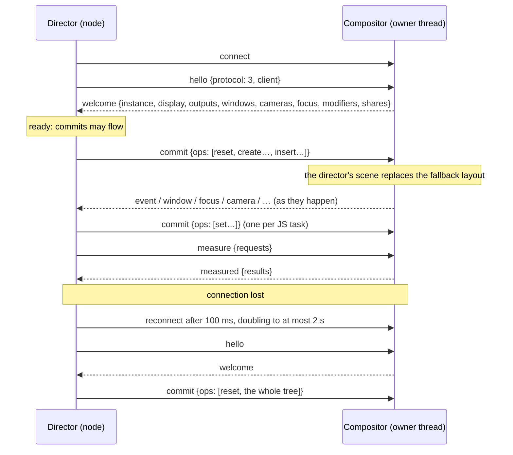

# Director protocol

How the TypeScript director (`node`, [`sdk`](../sdk)) and the compositor
([`src`](../src)) talk to each other. This is protocol version **3**.
[GUIDE.md](GUIDE.md) describes what the two ends do with it, and
[SHADERS.md](SHADERS.md) the design of its shaders.

| | Director (TypeScript) | Compositor (C) |
| --- | --- | --- |
| Socket and framing | [`connection.ts`](../sdk/src/connection.ts) | [`link.c`](../src/link.c) |
| JSON | `JSON.stringify` / `JSON.parse` | [`json.c`](../src/json.c) |
| Message types | [`protocol.ts`](../sdk/src/protocol.ts) | `dispatch` and `send_welcome` in `link.c`, and the `link_send` call sites |
| Session state and requests | [`session.ts`](../sdk/src/session.ts), [`store.ts`](../sdk/src/store.ts) | `window.c`, `output.c`, `camera.c`, `share.c`, `capture.c`, `clipboard.c` |
| Scene ops | [`host.ts`](../sdk/src/host.ts) | [`scene.c`](../src/scene.c) |
| Property values | [`props.ts`](../sdk/src/props.ts), [`motion.ts`](../sdk/src/motion.ts), [`color.ts`](../sdk/src/color.ts) | [`props.c`](../src/props.c) |
| Events | [`host.ts`](../sdk/src/host.ts) `dispatch`, [`events.ts`](../sdk/src/events.ts) | `input.c`, `manip.c`, `content.c`, `webnode.c`, `window.c` |
| Text measurement | [`layout.ts`](../sdk/src/layout.ts) | `content_measure_text` in `content.c` |
| Animation | [`animation.ts`](../sdk/src/animation.ts), [`motion.ts`](../sdk/src/motion.ts) | [`motion.c`](../src/motion.c) (curves, keyframe tracks) |
| Shaders | [`shader.ts`](../sdk/src/shader.ts) | [`shader.c`](../src/shader.c) (definitions), `scene.c` (uses), [`render.c`](../src/render.c) (programs) |

## Transport

**Socket.** The compositor listens on a Unix stream socket, by default
`$XDG_RUNTIME_DIR/proscenium-<compositor pid>.sock`, created with mode `0600`
and a backlog of 4. At startup an existing file at that path is probed: if
nothing accepts on it, the file is deleted; if something does, startup fails
with "Another compositor is listening".

**Launch.** `proscenium --script WORLD.tsx` starts the director as
`node --enable-source-maps sdk/bin/proscenium.mjs WORLD.tsx` with:

| Variable | Meaning |
| --- | --- |
| `PROSCENIUM_SOCKET` | The socket path (`--socket` overrides it). |
| `PROSCENIUM_PARENT` | The compositor's pid. Before each connection attempt the director exits if this is no longer its parent pid, so an orphaned director never retries forever. |
| `WAYLAND_DISPLAY` | The compositor's display, for clients the director launches. |

**Framing.** Each message is one JSON object encoded as UTF-8 and terminated by
`\n`. The director splits its input on `\n` and skips empty lines. The
compositor scans each byte only once for a newline. More than 8 MiB of input
without a newline ends the session; invalid UTF-8 makes a line invalid JSON.

**JSON dialect.** The compositor decodes with its own bounded parser:

- At most 16 levels of nesting, 1,000,000 values per message, and strings up
  to 8 MiB.
- Numbers must lie within ±2^53, with exponents of at most 308.
- Duplicate object keys are rejected.
- `null` and an absent key mean the same thing: both read as "not given", which
  resets a property.
- `false` stays distinct from `null`.

It writes lowercase kebab-case keys, such as `"screen-x"` and `"work-area"`.
Integers are written exactly and other numbers with six decimals.

**I/O.** On the compositor both the listening socket and the connection are
non-blocking file-descriptor sources on the compositor's event loop:

- **Reads:** the compositor reads in 64 KiB chunks until the socket would
  block, and handles each complete line as it arrives.
- **Writes:** the compositor queues encoded messages and sends as
  much as the socket takes. It watches for writability only while bytes remain
  queued.
- **Overflow:** a director that lets more than 16 MiB queue up is disconnected,
  with "it stopped reading events" in the log.

The director writes with `socket.write(JSON.stringify(message) + "\n")` and
leaves buffering to Node.

**Coalescing.** Most messages are sent immediately and in order. These are
coalesced instead:

- pointer motion and drag and resize progress (`pointermove`, a binding's `move`,
  `drag`, `resize`), keyed by node and event;
- camera reports, keyed by output.

A newer coalesced message replaces the pending one with the same key. Pending
messages are flushed at most once every 16 ms: by a timer, or by an idle callback
when that interval has already passed. Any other message flushes them first, so
the order of events is preserved.

## Session lifecycle



1. **Handshake.** The first line must be `hello` with `protocol: 3`; anything
   else ends the session with a fatal error. The compositor answers with
   `welcome` at once. The director treats the connection as ready only once
   `welcome` arrives. Until then, and while disconnected, `Connection.send`
   drops outgoing messages: commits are replayed later (step 4), and
   `screenshot()` rejects immediately.
2. **One director at a time.** A new connection replaces the current one. The
   old director receives
   `{type: "error", message: "Replaced by a newer director.", fatal: true}`
   and is closed. A director that receives a fatal error stops its connection
   instead of reconnecting.
3. **Taking over.** The director's first `commit` marks its scene active, which
   replaces the fallback layout the compositor uses when no director scene
   exists. That commit starts with `reset`, so the old top-level nodes are
   removed within the same transaction. Nodes with the same identity
   (`layoutId`, or `window:<id>` for windows) inherit their on-screen motion, so
   a restarted director takes over without anything jumping. Under a different
   parent, the inherited position is carried into the new parent's space.
4. **Disconnect.**
   - *Compositor side:* the director's pointer captures are released. If its
     scene was active, the fallback layout returns, so unplaced windows cascade
     on the first output and stay reachable. Shortcuts and bindings check that a
     director is connected, so they go quiet.
   - *Director side:* the scene is marked for full replay, pending screenshots
     are rejected, and reconnection is retried with backoff.
   - *Reconnect:* after the next `welcome`, the director sends its whole tree
     as one commit beginning with `reset`, and asks for the application catalog
     again if it had asked before.

## Errors

The compositor reports problems with
`{type: "error", message, fatal?: true}`. The director logs non-fatal errors
and keeps running. A fatal error stops its connection and calls `onRejected`,
and the runtime then shuts down.

| Condition | Outcome |
| --- | --- |
| First line is not `hello` for protocol 3 | Fatal; connection closed. |
| Input grows past 8 MiB without a newline | Fatal. |
| JSON that does not parse, before the handshake | Fatal. |
| JSON that does not parse, after the handshake | Non-fatal `Invalid JSON: …`; the next line is read normally. |
| A JSON value that is not an object | Fatal. |
| Unknown message type, a bad field, an unknown window/output/share | Non-fatal error naming the problem. |
| Rejected ops inside a commit | One non-fatal error per commit: `N ops rejected; first: …`. The other ops still apply. |
| More than 16 MiB of unsent output | Connection closed (nothing can be sent anymore). |
| A newer director connected | Fatal `Replaced by a newer director.` |

## Director → compositor

| Message | Fields | Effect |
| --- | --- | --- |
| `hello` | `protocol: 3`, `client` (the SDK sends `"proscenium"`) | Handshake; answered by `welcome`. |
| `commit` | `ops`: array of [ops](#scene-transactions) | One scene transaction. |
| `focus` | `window`: id or `null` | Focuses the window on the first seat, or clears focus. |
| `close` | `window`: id | Asks the client to close. |
| `camera` | `output`: name or `null` (every output); optional `x`, `y`, `zoom` (> 0), `rotation` (radians); optional `transition` ([motion](#motions)) | Moves cameras even to where they already are; reports come back as `camera`. |
| `set-clipboard` | `text`, or `mime` and `path` | Takes ownership of the first seat's clipboard with the text, or with the data of the file at `path` (in `$XDG_RUNTIME_DIR`, at most 64 MiB) offered as `mime`, e.g. `image/png`. The compositor reads the file and deletes it. |
| `warp-pointer` | `output`, `x`, `y` | Moves the pointer to (`x`, `y`) in the output's logical pixels, as if it had moved there: what it is over now hears it. |
| `grab-keyboard` | `grab`: boolean | While `true`, keys no shortcut takes come to the director as `key` messages instead of reaching windows and pages, which lose keyboard focus meanwhile. A key goes where its press went until it is released. |
| `watch-input` | `watch`: boolean | While `true`, every key and button press, wheel motion and gesture start is also told to the director as an `input` message; each still reaches its target. |
| `share-accept` | `id`, then `window`, or `output` (default: the first) with optional `region {x, y, width, height}` in output-logical pixels | Starts a screen share. The client must have asked for that kind of source, and the region must lie within the output and be at least 8×8. |
| `share-cancel` | `id` | Declines a pending share or stops a running one. |
| `capture` | `id` (non-negative integer), then a source as in `share-accept` | Takes a screenshot; answered by `captured`. |
| `measure` | `requests: [{key, props}]`, at most 1000 per message | Asks for text sizes; answered by `measured`. |

```json
{"type":"hello","protocol":3,"client":"proscenium"}
{"type":"camera","output":null,"x":400,"y":300,"zoom":2,"transition":{"type":"spring","stiffness":170,"damping":26,"mass":1}}
{"type":"capture","id":3,"output":"eDP-1","region":{"x":0,"y":0,"width":640,"height":400}}
```

## Scene transactions

A `commit` carries `ops`, applied in order as one transaction. Each op is
decoded and validated before it changes anything, so a rejected op leaves the
scene untouched and the remaining ops still apply. After the last op, the
compositor:

- hands motion over from removed nodes to created nodes with the same identity;
- starts the exit animations;
- re-indexes windows.

The new scene is presented in the next frame.

| Op | Fields | Semantics |
| --- | --- | --- |
| `create` | `id`, `type`, `props` | Creates a detached node. The `id` must be a positive integer that no live node uses. `type` is one of the [node types](#node-types). The `props` are applied as the node's initial declaration, starting from `initial` when it is given. |
| `set` | `id`, `props` | Merges `props` into the node. A key with `null` resets that property to its default; absent keys are left unchanged. |
| `insert` | `parent`, `id`, `before` | Puts the node into `parent` (`0` is the root) before sibling `before`, or last when `before` is `null`. Inserting an attached node moves it. Children paint in order, so later ones are on top. Cycles are rejected. |
| `remove` | `parent`, `id` | Removes the node and its subtree, and frees their ids at once. A removed node with an `exit` keeps painting until its exit values settle, unless a node created in the same commit takes over its identity. |
| `reset` | — | Removes every top-level node without exit animations, because a new director may reuse their ids. Nodes created in the same commit still inherit motion by identity. |
| `shader` | `id`, `stage`, `source`, `uniforms?`, `reads?`, `extent?`, `opaque?`, `hole?`, `gate?` | Defines a [shader](#shaders) nodes then use in their `shaders`. Definitions survive `reset` and are immutable: defining an id again is a no-op with the same content and an error otherwise. |

Besides the [properties](#properties), `props` may carry these keys, which
`create` and `set` apply before the values:

| Key | Value |
| --- | --- |
| `transition` | `{default?: motion, <wire property>?: motion, …}`. Replaces every motion of the node; a property without its own motion uses `default`, and with neither it changes instantly. Motions for properties the node type lacks are ignored. Because transitions apply before values, a commit that changes both animates the value with the new transition. |
| `initial` | `{<animated property>: value, shaders?: {<use id>: {<uniform>: value}}}`. Where animated values start on `create`; ignored by `set`. |
| `exit` | `{<animated property>: value, shaders?: {…}}` or `null`. What a removed node animates to before it disappears. |
| `shaders` | On `group`, `text`, `image`, `web`, `window` and `background` nodes: an array of up to 8 [shader uses](#uses), or `null`. Replaces the node's uses, keeping the displayed values of each one whose id remains. |
| `animate` | Array of up to 32 [animation tracks](#animation-tracks), or `null`. Replaces the node's animations. |
| `layoutId` | String or `null`. The node's identity for motion hand-over. Window nodes have `window:<id>` implicitly. |
| `handlers` | Array of [event names](#events). The compositor sends an event only for a name listed here, on the node or on an ancestor for bubbling events. Unknown names are ignored. |

While a native drag or resize holds a node's `x`, `y`, `width` or `height`,
declarations for those keys wait until the manipulation ends.

```json
{"type":"commit","ops":[
  {"op":"shader","id":"s1k3xq","stage":"paint","source":"vec4 paint(vec2 position) { … }",
   "uniforms":{"fill":4},"opaque":{"when":{"uniform":"fill","component":3}},
   "gate":{"uniform":"fill","component":3}},
  {"op":"reset"},
  {"op":"create","id":1,"type":"group","props":{"x":8,"y":8,"width":300,"height":34,"radius":12,
    "shaders":[{"id":"box","shader":"s1k3xq","uniforms":{"fill":[1,1,1,0.78]}}],
    "handlers":["pointerdown","pointerenter","pointerleave"],
    "transition":{"default":{"type":"spring","stiffness":110.6,"damping":17.7,"mass":1}},
    "initial":{"opacity":0,"y":-10}}},
  {"op":"create","id":2,"type":"text","props":{"text":"Hello <span weight=\"700\">world</span>",
    "markup":true,"fontSize":13,"x":8,"y":8,"width":82}},
  {"op":"insert","parent":1,"id":2,"before":null},
  {"op":"insert","parent":0,"id":1,"before":null}]}
{"type":"commit","ops":[{"op":"set","id":1,"props":{"radius":null,
  "shaders":[{"id":"box","shader":"s1k3xq","uniforms":{"fill":[0.18,0.44,0.93,0.12]}}]}}]}
```

### How the SDK produces commits

[`host.ts`](../sdk/src/host.ts) is the React reconciler host.

- **Attachment.** An instance exists from render time, but is first sent when
  React attaches it, so work React abandons is never sent. Attaching a subtree
  emits `create` for each node; each child's `create` is followed by its
  `insert`, and the subtree root's `insert` comes last.
- **One commit per task.** Everything React commits in one JavaScript task,
  including re-renders from `useLayoutEffect` and `onLayout`, is sent as one
  `commit`, from a microtask after React's own commit. A node changed twice in
  that time sends a single merged `set`. Node ids count up from 1 for the life
  of the process.
- **Layout.** `<Box>` layout (Yoga) runs before sending. A `create` already
  carries the node's computed `x`, `y`, `width` and `height`, and later layout
  changes are ordinary `set`s. Text nodes get no computed `height`, since the
  compositor lays out their lines.
- **Waiting for text sizes.** When layout needs text sizes it has not measured
  yet, sending waits for `measured`: at most 200 ms and three rounds, after
  which estimates are used.
- **Restoring dragged nodes.** After `dragend` or `resizeend`, any declared
  position or size the handler did not change is sent again, so the node
  returns to it. Movable, draggable and resizable nodes always subscribe to
  their end event for this, with or without a handler.
- **Shaders first.** A commit using a shader the compositor has not been sent
  starts with its `shader` op.
- **Replay.** After a reconnect, the next send is the `shader` ops of every
  shader in use, `reset`, and the whole attached tree.

## Node types

The compositor accepts exactly these properties per type, and rejects any
other. The SDK's `<Rect>` and `<Box>` are sent as `group`.

| `type` | Properties |
| --- | --- |
| `group` | transform, box, `clip`, `draggable`, `interactive`, `cursor` |
| `text` | transform, `width`, `text`, `markup`, `font`, `fontSize`, `fontWeight`, `italic`, `color`, `align`, `lineHeight`, `maxLines`, `draggable`, `interactive`, `cursor` |
| `image` | transform, box, `src`, `fit`, `draggable`, `interactive`, `cursor` |
| `web` | transform, box, `src`, `data`, `revision`, `focusable`, `interactive`, `autoFocus`, `frameTag`, `cursor` |
| `window` | transform, box, `window`, `fullscreen`, `maximized`, `tiled`, `focusable`, `interactive`, `movable`, `resizable` |
| `mirror` | transform, box, `window` |
| `background` | `x`, `y`, `transform`, `opacity`, `visible`, `backface`, `pan`, `cursor` |
| `camera` | `output`, `x`, `y`, `zoom`, `rotation`, `minZoom`, `maxZoom` |
| `screen` | `output`, `x`, `y`, `transform`, `opacity`, `visible`, `backface` |
| `reserve` | `output`, `top`, `right`, `bottom`, `left` |
| `shortcut` | `key`, `modifiers`, `repeat` |
| `pointer-binding` | `button`, `modifiers`, `action` |
| `wheel-binding` | `modifiers`, `action` |
| `gesture-binding` | `gesture`, `fingers`, `modifiers`, `action` |

*transform* is `x`, `y`, `transform`, `opacity`, `originX`, `originY`,
`visible` and `backface`. *box* is `width`, `height` and `radius`. The first
seven types also take the `shaders` key: everything a node shows beyond its own
content (a window's surfaces, a page, an image, text) comes from
[shaders](#shaders).

A `window` node shows a client window and configures it to its declared size;
while its size animates, its content is stretched to the box, and a frame of a
new size arriving on the way fades in over the previous frame, stretched
likewise, until the box arrives. A `mirror` draws the same window once more,
live, in its own box (the window's size without one): it takes no input,
configures nothing and does not count as presenting the window, though its
outputs receive the window's frames.

## Shaders

A shader is GLSL the director defines once with a `shader` op; nodes then use
it, with uniforms that animate like any property. Each has a stage:

| Stage | Defines | Draws |
| --- | --- | --- |
| `paint` | `vec4 paint(vec2 position)` | One draw over the node's box grown by its `extent` (or, on a `background`, over its whole plane), straight into the frame, under or over the node's content and always under its children. Fills, borders, shadows, backdrop blur and grids are paints. |
| `filter` | `vec4 filter(vec4 color, vec2 position)` | Nothing of its own: the node's content (window surfaces, page, image, text raster) is drawn through it, texel by texel. Dimming is a filter. A node takes one. |
| `effect` | `vec4 effect(vec2 position)` | The node and its subtree are drawn into an offscreen target, then through the shader over its box grown by its `extent` (or the whole output). A node takes one. |

```json
{"op":"shader","id":"s1x9k2","stage":"paint","source":"vec4 paint(vec2 position) { … }",
 "uniforms":{"color":4,"blur":1,"spread":1,"x":1,"y":1},
 "extent":{"uniforms":{"blur":1.5,"spread":1,"x":[-1,0,1,0],"y":[0,-1,0,1]},"floor":{"blur":1}},
 "gate":{"uniform":"color","component":3}}
```

| `shader` field | Rules |
| --- | --- |
| `id` | 1 to 64 of `A-Za-z0-9_-.:`. The SDK derives it from the definition. |
| `stage` | `"paint"`, `"filter"` or `"effect"`. |
| `source` | GLSL ES 1.0 defining the stage's function. At most 64 KiB. Colors are premultiplied. |
| `uniforms` | Name to 1, 2 or 4 values, in declaration order. At most 16 names, GLSL identifiers outside the `gl_`, `u_`, `v_`, `a_` and `stage_` prefixes, and none of `size`, `radius`, `pixel`, `time`, `pointer`, `paint`, `filter`, `effect`, `content`, `backdrop` and `main`. |
| `reads` | What it reads beyond its uniforms: `time`, `pointer` (all stages); `backdrop` (paints and effects): `true`, or for a paint `{blur: <float uniform>}`; `local` (effects): it reads `content` only at its own position. |
| `extent` | A [bound](#bounds): how far a paint or effect draws beyond the box. None: within it. |
| `opaque` | A paint's [region](#bounds) it covers opaquely while its condition holds and the node is fully opaque; what it hides is never drawn. A filter's `{when?}`: opaque content stays opaque through it. |
| `hole` | A paint's [region](#bounds) where it draws nothing while its condition holds: it is drawn, and repaints, as a ring around it. |
| `gate` | A component or a list of up to 4: unless one is above zero, the shader shows nothing and is skipped. A skipped effect leaves its node drawn as it is; a skipped filter, its content. |

A component is `{uniform, component?}` (`component` 0 by default).

### What a shader sees

The compositor wraps the source in a prelude that declares its uniforms and:

| Name | Value |
| --- | --- |
| `size` | The node's box (`vec2`); the output's for `area: "output"`. |
| `radius` | The node's corner radius. |
| `pixel` | Local units per output pixel, for antialiasing. |
| `time` | With `reads.time`: seconds the use's clock has run. |
| `pointer` | With `reads.pointer`: the first seat's pointer in local units, far away unless it is on this output. |
| `backdrop(position)` | With `reads.backdrop`: what is drawn behind, at a local position. A paint's is blurred by its `blur` uniform in local units. |
| `content(position)` | Effects: the node and its subtree as drawn. |

Positions are local units of the node, or output-logical pixels for
`area: "output"`, and a background's paints see its plane. A paint's and an
effect's result is multiplied by the node's opacity. A shader that does not
compile is reported as the `error` event of each node using it, once per
shader, with line numbers counted from the source's first line; a paint then
draws nothing, a filter or an effect leaves the node drawn as it is.

### Bounds

A bound gives four distances (left, top, right, bottom). A form sums `pad`
(local units), `pixel` (output pixels), `radius` (times the corner radius),
each a number or four, and for each uniform in `uniforms` its value, first
raised to its `floor`, times its coefficients: a number for every side, four,
or (for a vec2 or vec4) an array of four per component. A bound is one form,
or an array of up to 4 whose largest applies, side by side. The compositor
evaluates bounds every frame from the values shown, so quads, damage and
occlusion follow a shader exactly as it animates.

A region is `{inset?: bound, when?: component or list}`: the box less `inset`,
while every component of `when` is at least 1 (`opaque`) or at most 0 (`hole`).

### Uses

| `shaders` entry | Rules |
| --- | --- |
| `id` | 1 to 32 of `A-Za-z0-9_-`, unique on the node. |
| `shader` | A defined shader's id. A node uses at most one filter and one effect; a group, having no content, takes no filter, and a background only paints. |
| `uniforms` | Values by name, numbers or arrays of the uniform's size; those left out are 0. |
| `layer` | A paint's: `"under"` (default) or `"over"` the node's content. |
| `area` | A paint's or effect's: `"box"` (default), or `"output"`, covering the whole output in output-logical pixels. |
| `time` | `false` holds its clock where it is; it runs by default. A clock that runs while shown repaints every frame. |
| `transition` | A motion for its uniforms, or `{default?: motion, <uniform>?: motion}`; the node's `default` for what has none. |

Paints draw in order: those under the content, the content, those over it.
A use keeping its id keeps its displayed values, which move on to the new
ones, and its clock while it keeps its shader. A new use starts as declared on `create` (or from `initial`),
and from zero on a node already shown; a use no longer declared moves to zero,
then goes. A shader should therefore show nothing at all-zero uniforms.

## Properties

Every wire value is canonical, so the compositor only checks types and ranges:

- colors are straight-alpha `[r, g, b, a]` in 0..1;
- angles are in radians;
- durations are in seconds;
- sizes are in logical pixels.

| Type | Accepted JSON |
| --- | --- |
| number | A finite number with \|x\| < 10^12; `zoom` must also be > 0. |
| color | `[r, g, b, a]`; each component is clamped to 0..1. |
| boolean | `true` or `false`. |
| string | A string. |
| id | An integer in 0..2^53. |
| choice | One of the listed strings. |
| modifiers | An array of `"shift"`, `"control"`, `"alt"`, `"logo"`. |
| transform | An array of at most 32 functions, each an array of its name and numbers (below). |

Animated properties move through spring or tween channels; zoom animates its
logarithm. Non-animated ones apply at once. Camera nodes animate nothing: they
declare targets for cameras the compositor owns.

| Property | Type | Default | Animated |
| --- | --- | --- | --- |
| `x`, `y` | number | 0 | yes |
| `width`, `height` | number | natural size (none for text) | yes |
| `transform` | transform functions (below) | none | yes |
| `rotation` (camera) | number (radians) | 0 | yes |
| `opacity` | number | 1 | yes |
| `originX`, `originY` | number (fraction of size) | 0.5 | |
| `visible` | boolean | true | |
| `backface` | `"visible"` or `"hidden"`: whether the node, and its subtree, draws and takes the pointer while turned away from the viewer | `"visible"` | |
| `color` (text) | color | black | yes |
| `radius` | number | 0 | yes |
| `clip`, `draggable` | boolean | false | |
| `cursor` | choice: `none`, `default`, `pointer`, `text`, `crosshair`, `move`, `grab`, `grabbing`, `not-allowed`, `help`, `wait`, `progress`, `zoom-in`, `zoom-out`, `ew-resize`, `ns-resize`, `nwse-resize`, `nesw-resize` | inherited | |
| `window` | id | — | |
| `fullscreen`, `maximized`, `tiled`, `movable`, `resizable` | boolean | false | |
| `focusable`, `interactive` | boolean | true | |
| `text`, `font` | string | — | |
| `markup`, `italic` | boolean | false | |
| `fontSize`, `fontWeight` | number | 14, 400 | |
| `align` | choice: `start`, `center`, `end` | `start` | |
| `lineHeight` | number (multiple of the font's) | the font's | |
| `maxLines` | id | unlimited | |
| `src` | string (absolute path, page bundle or URL) | — | |
| `fit` | choice: `fill`, `contain`, `cover` | `fill` | |
| `data` | string (JSON text given to a page as its props) | — | |
| `revision` | number (a change reloads a page) | — | |
| `autoFocus` | boolean | false | |
| `frameTag` | number (a page frame marked with one of the node's last four numbers shows where the node was with that number, for up to a second) | — | |
| `pan` | boolean | false | |
| `output` | string | every output | |
| `zoom` | number (> 0) | 1 | yes (log) |
| `minZoom`, `maxZoom` | number | 0.05, 8 | |
| `top`, `right`, `bottom`, `left` | number | 0 | |
| `key` | string (an xkb keysym name) | — | |
| `modifiers` | modifiers | none | |
| `repeat` | boolean | false | |
| `button` | id (a Linux input code) | 272 | |
| `gesture` | choice: `swipe`, `pinch`, `hold` | `swipe` | |
| `fingers` | id | 3 | |
| `action` | choice: `none`, `move`, `resize`, `pan`, `zoom` | `none` | |

### Transform functions

A `transform` lists functions as CSS writes them; the last applies to the node
first, about its origin (`originX`, `originY`). Each composes as a 4x4 matrix
with the node's position and its ancestors', keeping depth, and the node draws
its z = 0 plane through the product. Positive y points down and z toward the
viewer.

| Function | Numbers |
| --- | --- |
| `["translate", x, y, z]` | Offsets. |
| `["scale", x, y, z]` | Factors. |
| `["rotate", x, y, z, angle]` | A turn of `angle` radians about the axis vector (CSS `rotate3d`); clockwise on screen about z. |
| `["skew", ax, ay]` | Slants, in radians. |
| `["perspective", distance]` | Views what follows from `distance` in front; 0 for none. |
| `["matrix", ...16]` | Any matrix, column by column as CSS `matrix3d()`. |

A change animates each number between lists of the same functions. When one
list begins the other, the shorter is padded with functions that do nothing
(rotations about the other list's axes), as CSS pads lists. Perspective moves
through its strength, the inverse of the distance. Other changes apply at
once. Keyframes of a transform track pad the same way, and an `add` track
appends its functions to the node's own.

### Motions

A motion is one of:

```json
{"type":"spring","stiffness":170,"damping":26,"mass":1,"delay":0,"velocity":-1200}
{"type":"tween","duration":0.25,"ease":[0.25,0.1,0.25,1],"delay":0,"repeat":0}
{"type":"curve","duration":0.5,"points":[0,0.4,1.1,1],"delay":0,"repeat":0}
{"type":"instant"}
```

| Kind | Field rules |
| --- | --- |
| `spring` | `stiffness`, `damping` and `mass` must be positive. `velocity`, optional, is the speed in units per second the value starts at when the spring retargets it, in place of the speed it had, as when a gesture lets go; every channel the motion retargets takes it. |
| `tween` | `duration` must be positive. `ease` is a CSS cubic-bezier with both x values in 0..1, or `null` for linear. `repeat` is 0..10000 extra runs, or `"forever"`. |
| `curve` | Like `tween`, but its progress follows `points` (2 to 1024 numbers), sampled evenly over `duration` and joined linearly; progress may leave 0..1 in between. |
| any | `delay` is at least 0. |

Omitted fields take the defaults shown above. The SDK's
`spring({duration, bounce})` converts to stiffness and damping before sending.
`tween(…, {repeat: Infinity})` becomes `"forever"`, and a `tween` with an
easing function becomes a `curve` with 120 points a second (at least 16, at
most 512).

### Animation tracks

```json
{"id":"nudge/x","property":"x","keyframes":[0,14,-4,0],"duration":0.32,
 "ease":[0,0,0.58,1],"composite":"add"}
```

| Field | Rules |
| --- | --- |
| `id` | String or integer. A track whose id the node already had keeps its start time, so it runs on, or stays finished; others start at the commit. |
| `property` | An animated property of the node's type, or `shaders.<use id>.<uniform>`. |
| `keyframes` | 2 to 1024 values of that property, all of one size; for a uniform, a number or 1, 2 or 4 numbers each. A track whose size is not its uniform's, or naming no use of the node, changes nothing. |
| `offsets` | Optional: as many numbers, rising from 0 to 1; even spacing by default. |
| `duration`, `delay` | Seconds per iteration (positive; 1 by default), and before the first (0). The property keeps its own value during the delay. |
| `ease` | Optional cubic-bezier applied to each iteration's progress; easing past the first or last keyframe extrapolates. |
| `iterations` | 1..1000000, or `"forever"`; 1 by default. |
| `direction` | `normal`, `reverse`, `alternate` or `alternate-reverse`. |
| `composite` | `replace` (default) shows the keyframes; `add` adds them to the property's value. |

Tracks apply in order over the property's value, whether declared or
transitioning. A finished track stops affecting it but stays declared, so
listing it again does not replay it. A removed node drops its endless tracks
and keeps its others while it exits.

### From SDK props to wire props

[`props.ts`](../sdk/src/props.ts) turns each element's ergonomic props
into the flat wire form.

**Geometry and paint**

| SDK prop | Wire |
| --- | --- |
| `rotation` (Camera, degrees) | `rotation` (radians) |
| `transform` (helpers in degrees) | Transform functions with angles in radians |
| `width`, `height` | The same when numbers. Percentages only affect `<Box>` layout. |
| `shaders` | `shaders` entries; shader objects become their ids, and the commit that first uses a shader defines it first (again after a reconnect). Colors in uniforms become vec4s. `transition.shaders` is the motion of uses without their own. |
| CSS colors (`#rgb[a]`, `#rrggbb[aa]`, `rgb()`, `rgba()`, names) | `[r, g, b, a]` |

**Decorations** become uses of the SDK's standard shaders, with fixed ids, in
the order they draw: `shadow`, `blur`, the node's own paints under its content,
then `box`. A frame (a Window's or Web's border) goes before `blur`, which lies
inside it, and a background's `plane` comes first.

| SDK prop | Use |
| --- | --- |
| `shadow: {color, blur, x, y, spread}`, `blur` (Rect, Box, Image, Web, Window) | `shadow` of `boxShadow`, moving with `transition.shadow`; `blur` of `backdropBlur`, uniform `blur`, moving with `transition.blur`. |
| `fill` (Rect, Box) | `box` of `boxPaint`: a color sets `fill` and `fillEnd`; `{from, to, angle}` sets `fill`, `fillEnd` and `fillAngle` (radians). |
| `border: {width, color}` | `box` of `boxPaint`: `border`, `borderColor`, `borderColorEnd`, `borderAngle`. A Window's and a Web's lies outside the box (`outset` = `width`); an Image's is drawn over it (`layer: "over"`). |
| `dim` (Window) | `dim` of `dimFilter`, uniform `amount`. |
| `fill`, `grid: {kind, color, spacing, size}` (Background) | `plane` of `planePaint`: `color`, `gridColor`, `spacing`, `weight`, `lines`. |

`transition.fill`, `.border`, `.fillAngle` and `.borderAngle` move the box's
uniforms they name, `transition.grid` the plane's.

**Text**

| SDK prop | Wire |
| --- | --- |
| `size`, `weight` | `fontSize`, `fontWeight` (`normal` 400, `bold` 700) |
| String or number children | `text` |
| Nested `<Text>` children | `text` as escaped Pango markup with `<span>`s, plus `markup: true` |

**Images, pages and other node types**

| SDK prop | Wire |
| --- | --- |
| `Image` `src` | The path, resolved against the world file |
| `Web` `props` | `data` (JSON text) |
| `Shortcut` `keys="Super+Shift+Enter"` | `key: "Return"`, `modifiers: ["logo", "shift"]` (sorted; `super`/`meta` mean `logo`, `ctrl` means `control`) |
| `PointerBinding` `button` | `left`/`right`/`middle` → 272/273/274 |

**Layout and visibility**

| SDK prop | Wire |
| --- | --- |
| `<Box>`, `<Rect>` | `type: "group"`. Layout props (`flexDirection`, `padding`, `gap`, …) are never sent; the computed `x`, `y`, `width` and `height` are. |
| `display="none"`, or hidden by Suspense | `visible: false` |

**Events, motion and identity**

| SDK prop | Wire |
| --- | --- |
| `onPointerDown`, `onDragEnd`, … | `handlers: ["dragend", "pointerdown", …]` (sorted) |
| `transition` | One motion becomes `{default}`. Motions of decorations and `shaders` go to their uses; the rest are expanded to the wire properties they cover. |
| `initial`, `exit` | The same writers as the props, limited to animated values; decorations and `shaders: {<use id>: {<uniform>: value}}` go to `shaders`. |
| `layoutId` | `layoutId` |
| `animate` | One track per animated wire property, with units converted (angles in radians). Decorations address their uses' uniforms: `fill` → `shaders.box.fill` and `shaders.box.fillEnd`, `shadowBlur` → `shaders.shadow.blur`, and so on; `shaders: {<use id>: {<uniform>: keyframes}}` → `shaders.<use id>.<uniform>`. Keyframe functions are sampled at 60 a second (9 to 257 keyframes) and easing functions are baked into the keyframes. The `id` is `<key>/<property>` with a `key`, else a hash of the track. |

A removed prop is sent as `null`, which restores its default.

## Compositor → director

| Message | Fields |
| --- | --- |
| `welcome` | `protocol`, `instance` (names this compositor process: window ids start over in the next), `display` (the Wayland socket name), `outputs`, `windows` (by id), `cameras` (one per output), `focus` and `modifiers` (one per seat), `shares` |
| `window` | `window: {id, title, app, mapped, width, height, parent, "min-width", "min-height", "max-width", "max-height"}`. Sent when anything in it changes. `width`/`height` are the client's own size, rounded. `parent` is the window this one belongs to, as a dialog does (xdg_toplevel `set_parent`, X11 `WM_TRANSIENT_FOR`), or `null`. The limits are the sizes the client accepts; 0 leaves a bound free. |
| `window-removed` | `id` |
| `output` | `output: {name, x, width, height, scale, "work-area": {x, y, width, height}}`. Outputs form one row, and `x` is the offset in it. `work-area` is the output-local area left after reservations such as a bar. |
| `output-removed` | `name` |
| `focus` | `seat`, `window` (id or `null`) |
| `modifiers` | `seat`, `modifiers` (held `shift`, `control`, `alt`, `logo`). Sent when they change. |
| `camera` | `output`, `x`, `y`, `zoom`, `rotation` (radians). Where the camera is headed; coalesced per output, and sent only when changed. |
| `clipboard` | `text`, copied by a client. Selections that password managers mark secret are never read. |
| `shares` | `shares: [{id, app, types, source, window, output}]`. `types` lists `"screen"` and/or `"window"`; `source` is `null` while the share waits for an answer. |
| `captured` | `id`, `path`, `width`, `height`, or `id` and `error` |
| `measured` | `results: [{key, width, height}]` |
| `key` | `key` (keysym name), `text` (what it types, or empty), `code` (evdev), `pressed`, `repeat`, `modifiers`: a key the director's keyboard grab took. Held keys repeat after 500 ms, about 33 times a second. |
| `input` | `kind` (`key`, `button`, `wheel` or `gesture`); `key` adds `key`, `button` adds `button`: input the director watches. |
| `event` | `node`, `name`, plus fields; see [Events](#events) |
| `error` | `message`, `fatal` |

```json
{"type":"welcome","protocol":3,"instance":"T3KXQ1-8Z2M0C1","display":"wayland-1",
 "outputs":[{"name":"eDP-1","x":0,"width":1280,"height":800,"scale":2.000000,
   "work-area":{"x":0,"y":48,"width":1280,"height":752}}],
 "shares":[],"windows":[{"id":3,"title":"Terminal","app":"foot","mapped":true,"width":800,"height":600,
   "parent":null,"min-width":0,"min-height":0,"max-width":0,"max-height":0}],
 "cameras":[{"output":"eDP-1","x":640.000000,"y":400.000000,"zoom":1.000000,"rotation":0.000000}],
 "focus":[{"seat":"seat0","window":3}],"modifiers":[{"seat":"seat0","modifiers":[]}]}
```

The director mirrors these messages in its `Store`, which the hooks read
(`useWindows`, `useOutputs`, `useFocusedWindow`, `useCamera`, `useShares`, …).
A collection that did not change keeps its identity, so components that read it
skip rendering.

## Events

```json
{"type":"event","node":12,"name":"pointerdown","button":272,"output":"eDP-1",
 "screen-x":512.5,"screen-y":20,"world-x":512.5,"world-y":20,"modifiers":["logo"],
 "x":503.5,"y":11,"local-x":40.5,"local-y":11}
```

`node` is the target node's id and `name` the event. The compositor sends an
event only if the node lists that name in `handlers`. For the bubbling pointer
events (`pointerdown`, `pointermove`, `pointerup`, `pointerenter`,
`pointerleave`, `wheel`), it also sends the event when only an ancestor lists
it, with `node` still being the node under the pointer.

The director then:

- finds the instance by id;
- converts the fields to camelCase (`screen-x` becomes `screenX`);
- adds `target`, `currentTarget` and `stopPropagation()`;
- bubbles the event through the instance's ancestors, as the DOM does.

For `pointerenter` and `pointerleave`, the `from`/`to` fields name the node the
pointer came from or went to. The director turns that into `relatedTarget`, and
calls the handlers of exactly the ancestors whose boxes the pointer entered or
left.

**Pointer fields.** Every pointer event carries:

- `output`;
- `screen-x`, `screen-y`: output-logical pixels;
- `world-x`, `world-y`: through that output's camera;
- `modifiers`.

When the event has a hit node, as presses, moves, wheels and captured pointers
do, it also carries:

- `x`, `y`: in the node's parent space;
- `local-x`, `local-y`: in the node's own space.

| Event | Sent to | Extra fields |
| --- | --- | --- |
| `pointerdown`, `pointerup` | The node under the pointer; `pointerup` goes to the capturing node | `button` (Linux code), pointer fields |
| `pointermove` | The node under the pointer, or the capturing node | Pointer fields (coalesced) |
| `pointerenter`, `pointerleave` | The topmost hit node, as it changes | `from` / `to` (node id or `null`), pointer fields without the hit fields |
| `wheel` | The node under the pointer, or a `wheel-binding` | `orientation` (`vertical`/`horizontal`), `delta`, `discrete`, `source` (`wheel`, `finger`, `continuous`, `wheel-tilt`), pointer fields; a binding also gets `window` |
| `down`, `move`, `up` | `pointer-binding` | Pointer fields; `down` and `up` add `button`, and the first `down` adds `window` (the window under the pointer, or `null`) |
| `begin`, `update`, `end` | `gesture-binding` | `fingers`, `dx`, `dy`, `scale`, `rotation`, `cancelled`; `begin` adds pointer fields |
| `press`, `release` | `shortcut` | — |
| `dragstart`, `drag`, `dragend` | A `draggable` or `movable` node | `x`, `y` (`drag` is coalesced) |
| `resizestart`, `resize`, `resizeend` | A `resizable` window | `x`, `y`, `width`, `height` (`resize` is coalesced) |
| `moverequest`, `resizerequest` | A window whose client asked to move or resize | Pointer fields; `resizerequest` adds `edges` (xdg_toplevel edges). The pointer stays captured by the node until release. |
| `fullscreenrequest`, `maximizerequest`, `minimizerequest` | A window | `value` (boolean) |
| `activaterequest` | A window whose client asked to be shown and focused; unhandled, the window is focused | — |
| `measure` | `text` | `width`, `height` after its layout changed |
| `load` | `image` (with `width`, `height`), `web` | — |
| `error` | `image`, `web`; any node using a shader that failed to build | `message` |
| `message` | `web` | `payload`: the JSON text of `{name, value}` from the page's `send()` |

The director runs updates from a press as React DOM runs a click's, before it
handles the next event. Updates from `pointermove`, `wheel`, `drag`, `resize`,
`move` and `update` are batched.

## Request and response pairs

**Text measurement** (`measure` / `measured`). A request is
`{key, props}`, where `props` may hold the text properties `text`, `markup`,
`font`, `fontSize`, `fontWeight`, `italic`, `align`, `width` (the wrap width),
`lineHeight` and `maxLines`, in their wire form. The compositor answers on the
same turn: Pango lays out each text exactly as a text node would, and the
compositor returns its logical `width` and `height`. The SDK:

- numbers keys from 1;
- caches sizes by their props (4,096 entries) and rounds them up to whole
  pixels;
- sends a request only for text whose size it does not know yet.

```json
{"type":"measure","requests":[{"key":7,"props":{"text":"Hello","fontSize":13,"fontWeight":600}}]}
{"type":"measured","results":[{"key":7,"width":33.000000,"height":18.000000}]}
```

**Screenshots** (`capture` / `captured`).
- *Rendering:* the compositor renders the source offscreen, as the outputs show
  it now, at full resolution, scaled down only to fit 8192 pixels per side.
- *Handoff:* it writes the pixels to
  `$XDG_RUNTIME_DIR/proscenium-<compositor pid>-capture-<id>.rgba` as
  `width × height × 4` bytes of RGBA, top row first, then sends the path.
  Encoding stays off the compositor's loop.
- *Cleanup:* from then on the file belongs to the director, which reads it,
  deletes it, and resolves `screenshot()`.
- *Failure:* a failed capture answers `{id, error}`.


## Changing the protocol

A new message or property touches both ends:

1. **Types:** declare it in [`protocol.ts`](../sdk/src/protocol.ts).
2. **C:**
   - handle it in `dispatch` (`link.c`), or add a row to `PROP_SPECS` and the
     node kind's list in `props.c` (with its `enum prop_key` in `props.h`);
   - add an event name to `EVENT_NAMES`.
3. **SDK writer:** for a property, add it to the `fields` table in
   [`props.ts`](../sdk/src/props.ts), and to `animatedWireNames` if it
   animates.
4. **Docs and tests:** document it here, and cover it in the SDK tests or a
   headless session (see [README.md](../README.md#testing)).

The protocol is at version 3, since shaders replaced every built-in decoration.
Additions that old directors can ignore keep the version: a new message type,
an optional field, a new event. An incompatible change bumps `PROTOCOL_VERSION`
in `link.h` and `PROTOCOL_VERSION` in `protocol.ts` together, because the
handshake requires them to match exactly.
